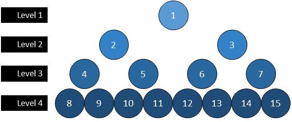

# Elixir Approach and Solution: Simple, No Queue, DFS, O(n) Time, O(log n) Space

**Author:** bpfaust
**Votes:** 1
**Link:** [https://leetcode.com/problems/maximum-width-of-binary-tree/solutions/1805011/](https://leetcode.com/problems/maximum-width-of-binary-tree/solutions/1805011/)

---

# Theory
Starting with the first node of a tree as index 1, and incrementing each node thereafter in BFS left-to-right fashion, the index of the left child for any node is equal to double the current index, and the index of the right child is one greater than the left child. 



# Approach
1. Recursively step down the binary tree in what I believe is a DFS fashion; this due to the recursive definition of the function. 
2. As we step through each node, create a map that tracks the left-most and right-most index of each level. 
3. If a child is `nil` we will not consider its index, leaving the left-most and right-most indices recorded for a level unchanged. This therefore trims `nil` values that may fall on the extreme left and right of a row. 
4. With the map of the left-most and right-most indicides of each level complete, and tracking the maximum width - `max_width` of a level observed so far in the operation, step across each level and calculate its width as `right - left + 1`. If this value, defined as `level_width` is greater than the maximum width, redefine the `max_width` as it. 
5. This `max_width` is returned as the reduced value. 

# Time and Space
Stepping across each node in the tree should be an O(n) operation, with `n` representing the total number of nodes in the tree. Though this is a recursive operation, we are only stepping across each node of the total `n` collection once. After that, and not in any recursive fashion, we step across each level of the tree, which we can refer to as `m`. I believe the true time of this script is O(n+m), but because `m` is much smaller than `n` and this is a linear operation, we discount the effect of `m` and consider this an O(n) time complexity. `m` itself should, at the worst case, be log_2 of `n` therefore making the true time O(n + log n). 

For space, because we are only creating a map based upon the levels and with a fixed length of values, the total depth of the map should truly only be proportional to the log_2 of `n` at worst case. 

If this is the wrong way of figuring time and space complexities, do let me know in the comments so I may revise this text accordingly. 
# Solution
```
# Definition for a binary tree node.
#
# defmodule TreeNode do
#   @type t :: %__MODULE__{
#           val: integer,
#           left: TreeNode.t() | nil,
#           right: TreeNode.t() | nil
#         }
#   defstruct val: 0, left: nil, right: nil
# end

defmodule Solution do
  @spec width_of_binary_tree(root :: TreeNode.t | nil) :: integer
  def width_of_binary_tree(root) do
    build_map(%{}, root, 1, 1)
    |> Enum.reduce(0, fn {level, {left, right}}, max_width ->
         if (level_width = right - left + 1) > max_width, do: level_width, else: max_width
       end)
  end
    
  def build_map(map, nil, _level, _index) do
    map
  end
    
  def build_map(map, node, level, index) do
    map
    |> Map.update(level, {index, index}, fn {l, _r} -> {l, index} end)
    |> build_map(node.left, level + 1, 2*index)
    |> build_map(node.right, level + 1, 2*index + 1)
  end
end
```

# Testcases
```
[1,3,2,5,null,null,9,6,null,null,7]
[1,3,2,5,3,null,9]
[1,3,null,5,3]
[1,3,2,5]
```