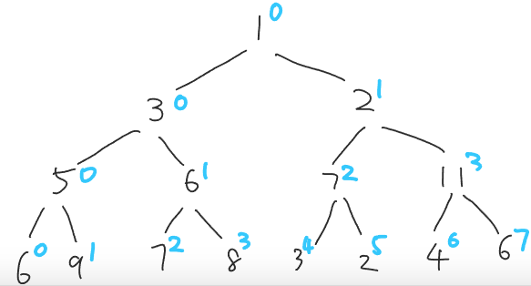

# Simple DFS python with drawing explanation

**Author:** rewreu
**Votes:** 64
**Link:** [https://leetcode.com/problems/maximum-width-of-binary-tree/solutions/750068/](https://leetcode.com/problems/maximum-width-of-binary-tree/solutions/750068/)

---

The idea is simple, as shown in the drawing below, blue number is the `column`. From observation, each node
`node.left.column = node.column*2`
`node.right.column = node.column*2+1`
We only need to traversal all the nodes and record the columns in by level 



```
from collections import defaultdict
class Solution:
    def widthOfBinaryTree(self, root: TreeNode) -> int:
        di = defaultdict(list)
        def dfs(node, level, column):
            if node:
                di[level].append(column)
                dfs(node.left, level+1, column*2)
                dfs(node.right, level+1, column*2+1)
        dfs(root, 0 , 0)
        return max([max(di[level]) - min(di[level]) +1 for level in di])
```