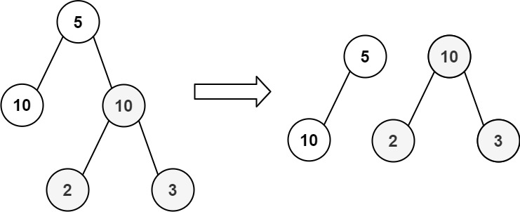
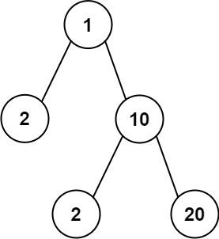

# [663. Equal Tree Partition](https://leetcode.com/problems/equal-tree-partition/)

| Category | Difficulty | Likes | Dislikes |
| :------: | :--------: | :---: | :------: |
| Algorithms | Medium | 507 | 37 |

**Tags:** [`tree`](https://leetcode.com/tag/tree), [`depth-first-search`](https://leetcode.com/tag/depth-first-search), [`binary-tree`](https://leetcode.com/tag/binary-tree)

**Companies:** `amazon`

## Description

Given the `root` of a binary tree, return `true`* if you can partition the tree into two trees with equal sums of values after removing exactly one edge on the original tree*.

 

**Example 1:**


```

Input: root = [5,10,10,null,null,2,3]
Output: true

```

**Example 2:**


```

Input: root = [1,2,10,null,null,2,20]
Output: false
Explanation: You cannot split the tree into two trees with equal sums after removing exactly one edge on the tree.

```

 

**Constraints:**

	- The number of nodes in the tree is in the range `[1, 10^4]`.

	- `-10^5 <= Node.val <= 10^5`

---

**Links:** [Submissions](https://leetcode.com/problems/equal-tree-partition/) | [Solutions](https://leetcode.com/problems/equal-tree-partition/)
