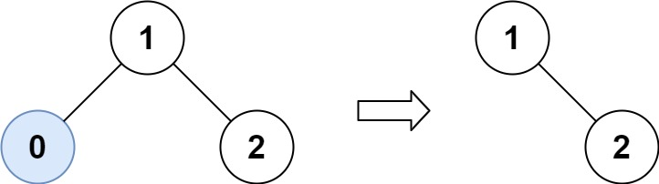
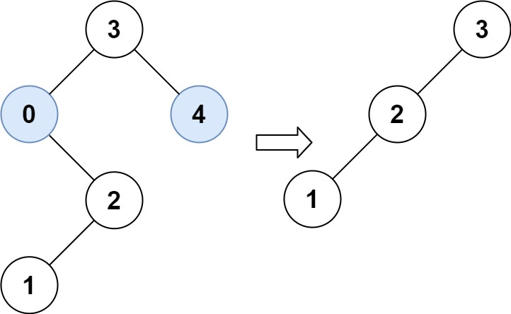

# [669. Trim a Binary Search Tree](https://leetcode.com/problems/trim-a-binary-search-tree/)

| Category | Difficulty | Likes | Dislikes |
| :------: | :--------: | :---: | :------: |
| Algorithms | Medium | 6063 | 264 |

**Tags:** [`tree`](https://leetcode.com/tag/tree), [`depth-first-search`](https://leetcode.com/tag/depth-first-search), [`binary-search-tree`](https://leetcode.com/tag/binary-search-tree), [`binary-tree`](https://leetcode.com/tag/binary-tree)

**Companies:** `google`, `amazon`, `bloomberg`

## Description

Given the `root` of a binary search tree and the lowest and highest boundaries as `low` and `high`, trim the tree so that all its elements lies in `[low, high]`. Trimming the tree should **not** change the relative structure of the elements that will remain in the tree (i.e., any node's descendant should remain a descendant). It can be proven that there is a **unique answer**.

Return *the root of the trimmed binary search tree*. Note that the root may change depending on the given bounds.

 

**Example 1:**


```

Input: root = [1,0,2], low = 1, high = 2
Output: [1,null,2]

```

**Example 2:**


```

Input: root = [3,0,4,null,2,null,null,1], low = 1, high = 3
Output: [3,2,null,1]

```

 

**Constraints:**

	- The number of nodes in the tree is in the range `[1, 10^4]`.

	- `0 <= Node.val <= 10^4`

	- The value of each node in the tree is **unique**.

	- `root` is guaranteed to be a valid binary search tree.

	- `0 <= low <= high <= 10^4`

---

**Links:** [Submissions](https://leetcode.com/problems/trim-a-binary-search-tree/) | [Solutions](https://leetcode.com/problems/trim-a-binary-search-tree/)
