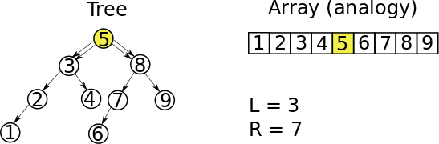
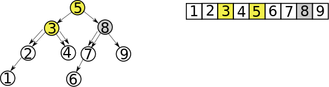
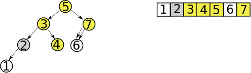
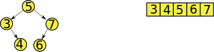

# C++: Detailed explanation. Recursive Approach

**Author:** andnik
**Votes:** 186
**Link:** [https://leetcode.com/problems/trim-a-binary-search-tree/solutions/501234/](https://leetcode.com/problems/trim-a-binary-search-tree/solutions/501234/)

---

##### Clarification
Before we get to the algorithm, let's clarify our task:
1. We have binary search tree. Variable `root` is pointer to the tree root.
2. We have boundaries `[L..R]`
3. We need to trim our tree so that all elements fit into boundaries `[L..R]`

##### Algorithm
Binary search tree stores a list of numbers in sorted format:
* `Parent` > all `left` children
* `Parent` < all `right` children.

So, our task is very similar to if we had sorted array and neeeded to find subarray that fits into boundaries `[L..R]`. For instance:
```
A = [1, 2, 3, 4, 5, 6, 7, 8, 9], L = 3, R = 7
Result =  [3, 4, 5, 6, 7] 
```
Let's work with this example in a tree:


Current node is `5` and `5 >= L && 5 <= R`, meaning we leave 5 as part of the result, but we don't know which `left` and `right` children `5` going to have.
So, we say: 
```
root->left = trimBST(root->left, L, R);
root->right = trimBST(root->right, L, R);
```

If `node == NULL` then we just return `NULL`.
Otherwise we compare node's value with `[L..R]` again:


For **left child**: `3 >= L && 3 <= R`, we going to return `3` as a left child of `5`, before we going to find left and right children of `3`.
For the **right child**: `8 > R`, meaning it's not going to be a right child of `5`, but `8's` left child can still be a chilf of `5`, so we return `trimBST(root->left, L, R);`.

And so on, untill we return all children for all nodes and return root at the end.
Graphically it looks like this:




##### Code
```
class Solution {
public:
    TreeNode* trimBST(TreeNode* root, int L, int R) {
        if (!root) return root;
        if (root->val >= L && root->val <= R) {
            root->left = trimBST(root->left, L, R);
            root->right = trimBST(root->right, L, R);
            return root;
        }
        if (root->val < L)
            return trimBST(root->right, L, R);
        return trimBST(root->left, L, R);
    }
};
```