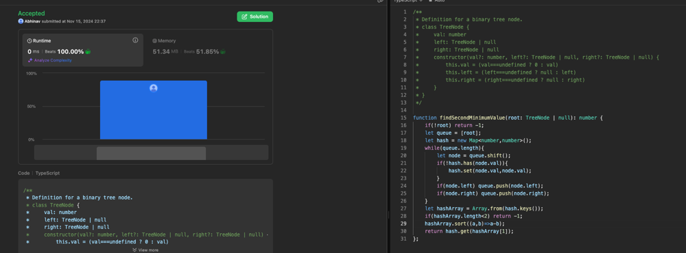

# Beats 100 % [with proof] || My easy solution using BFS interatively

**Author:** abhinavleadsquared
**Votes:** 0
**Link:** [https://leetcode.com/problems/second-minimum-node-in-a-binary-tree/solutions/6048468/](https://leetcode.com/problems/second-minimum-node-in-a-binary-tree/solutions/6048468/)

---

# Intuition

<!-- Describe your first thoughts on how to solve this problem. -->

# Approach
<!-- Describe your approach to solving the problem. -->

# Complexity
- Time complexity:
<!-- Add your time complexity here, e.g. $$O(n)$$ -->

- Space complexity:
<!-- Add your space complexity here, e.g. $$O(n)$$ -->

# Code
```typescript []
/**
 * Definition for a binary tree node.
 * class TreeNode {
 *     val: number
 *     left: TreeNode | null
 *     right: TreeNode | null
 *     constructor(val?: number, left?: TreeNode | null, right?: TreeNode | null) {
 *         this.val = (val===undefined ? 0 : val)
 *         this.left = (left===undefined ? null : left)
 *         this.right = (right===undefined ? null : right)
 *     }
 * }
 */

function findSecondMinimumValue(root: TreeNode | null): number {
    if(!root) return -1;
    let queue = [root];
    let hash = new Map<number,number>();
    while(queue.length){
        let node = queue.shift();
        if(!hash.has(node.val)){
            hash.set(node.val,node.val);
        }
        if(node.left) queue.push(node.left);
        if(node.right) queue.push(node.right);
    }
    let hashArray = Array.from(hash.keys());
    if(hashArray.length<2) return -1;
    hashArray.sort((a,b)=>a-b);
    return hash.get(hashArray[1]);
};
```