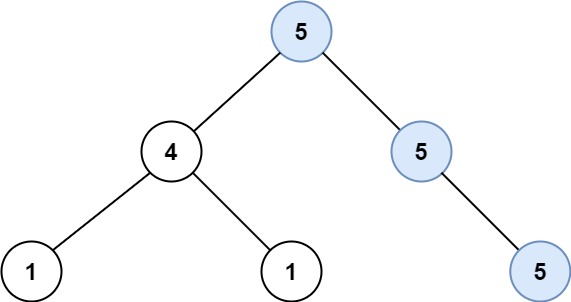
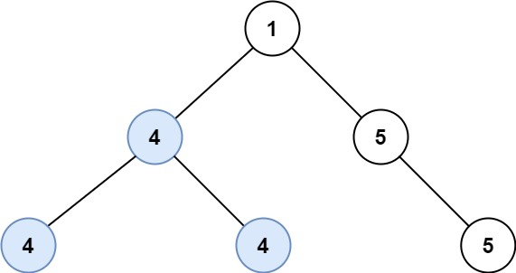

# [687. Longest Univalue Path](https://leetcode.com/problems/longest-univalue-path/)

| Category | Difficulty | Likes | Dislikes |
| :------: | :--------: | :---: | :------: |
| Algorithms | Medium | 4416 | 679 |

**Tags:** [`tree`](https://leetcode.com/tag/tree), [`depth-first-search`](https://leetcode.com/tag/depth-first-search), [`binary-tree`](https://leetcode.com/tag/binary-tree)

**Companies:** `sprinklr`, `snowflake`, `facebook`, `bloomberg`, `google`

## Description

Given the `root` of a binary tree, return *the length of the longest path, where each node in the path has the same value*. This path may or may not pass through the root.

**The length of the path** between two nodes is represented by the number of edges between them.

 

**Example 1:**


```

Input: root = [5,4,5,1,1,null,5]
Output: 2
Explanation: The shown image shows that the longest path of the same value (i.e. 5).

```

**Example 2:**


```

Input: root = [1,4,5,4,4,null,5]
Output: 2
Explanation: The shown image shows that the longest path of the same value (i.e. 4).

```

 

**Constraints:**

	- The number of nodes in the tree is in the range `[0, 10^4]`.

	- `-1000 <= Node.val <= 1000`

	- The depth of the tree will not exceed `1000`.

---

**Links:** [Submissions](https://leetcode.com/problems/longest-univalue-path/) | [Solutions](https://leetcode.com/problems/longest-univalue-path/)
