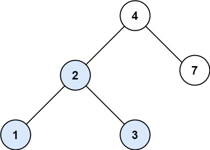
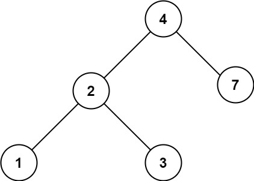

# [700. Search in a Binary Search Tree](https://leetcode.com/problems/search-in-a-binary-search-tree/)

| Category | Difficulty | Likes | Dislikes |
| :------: | :--------: | :---: | :------: |
| Algorithms | Easy | 6456 | 214 |

**Tags:** [`tree`](https://leetcode.com/tag/tree), [`binary-search-tree`](https://leetcode.com/tag/binary-search-tree), [`binary-tree`](https://leetcode.com/tag/binary-tree)

**Companies:** `amazon`, `facebook`, `microsoft`, `bloomberg`, `google`, `adobe`, `oracle`

## Description

You are given the `root` of a binary search tree (BST) and an integer `val`.

Find the node in the BST that the node's value equals `val` and return the subtree rooted with that node. If such a node does not exist, return `null`.

 

**Example 1:**


```

Input: root = [4,2,7,1,3], val = 2
Output: [2,1,3]

```

**Example 2:**


```

Input: root = [4,2,7,1,3], val = 5
Output: []

```

 

**Constraints:**

	- The number of nodes in the tree is in the range `[1, 5000]`.

	- `1 <= Node.val <= 10^7`

	- `root` is a binary search tree.

	- `1 <= val <= 10^7`

---

**Links:** [Submissions](https://leetcode.com/problems/search-in-a-binary-search-tree/) | [Solutions](https://leetcode.com/problems/search-in-a-binary-search-tree/)
