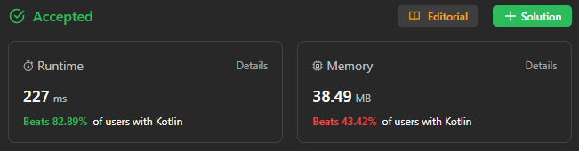

# ✅ 82% 🍒 binary search || understandable

**Author:** sunnoca
**Votes:** 1
**Link:** [https://leetcode.com/problems/search-in-a-binary-search-tree/solutions/4269192/](https://leetcode.com/problems/search-in-a-binary-search-tree/solutions/4269192/)

---

# Please Upvote \uD83D\uDD1D Appreciations!


# Complexity
- Time complexity: **O(** log(n) **)**
- Space complexity: **O(** 1 **)**
# Code
```
class Solution {
    fun searchBST(root: TreeNode?, value: Int): TreeNode? {
        var next = root

        while (next != null) {
            next = if (next.`val` == value) break
            else if (next.`val` > value) next.left else next.right
        }

        return next
    }
}
```