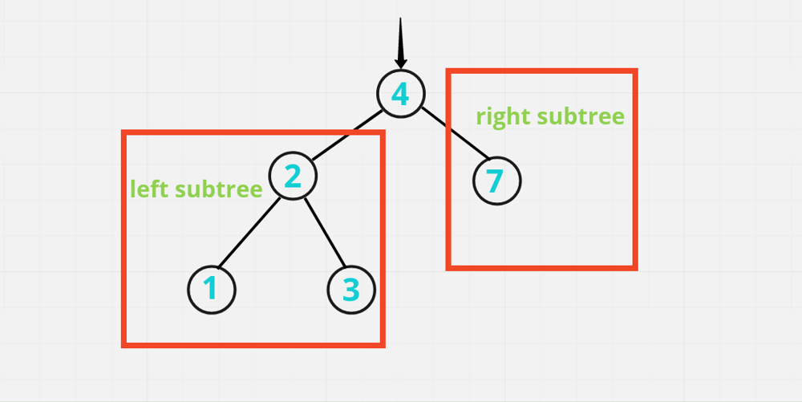
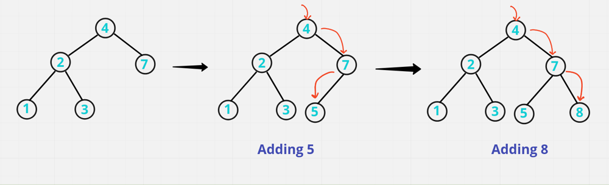

# 🧠 Well Detailed Explaination [Java , C++, Python] || Easy for mind to Accept it

**Author:** hi-malik
**Votes:** 317
**Link:** [https://leetcode.com/problems/insert-into-a-binary-search-tree/solutions/1683942/](https://leetcode.com/problems/insert-into-a-binary-search-tree/solutions/1683942/)

---

Guy's if you find this solution helpful \uD83D\uDE0A, PLEASE do UPVOTE. By doing that it motivate's me to create more better post like this \u270D\uFE0F

**So Ladies n Gentlemen without any further due let's start,**
`In this problem given a root node of binary search tree and the value & that value we need to add in Binary Search Tree & also saying all the nodes in BST have unique value & the value we need to add is not present in tree.`

**Approach Explain :**

**Summary :**
If the **root** is empty, the new tree node can be returned as the root node.

Otherwise compare **root. val** is related to the size of the target value:

* If **root.val** is greater than the **target value**, indicating that the target value should be inserted into the **left subtree of the root**, and the problem becomes root. Insert the target value in the left and recursively call the current function;
* If **root.val** is less than the **target value**, indicating that the target value should be inserted into the **right subtree of the root**, and the problem becomes root. Insert the target value in right and recursively call the current function.

**Explanation:**
In Binary search tree follow the property, all the nodes on **right subtree**, value is **greater** then the **root value** & all the nodes on **left subtree**, value is **less** then the **root value**.



So, now let's say we need to **add 5**. We will first compare with the **root node**. If it is less then we go on to the left subtree, if it is greater then we go to the right subtree. So, in this **example** **right subtree exist** and we will compare with **7**. Then it will go to the left & left subtree doesn't exist over here, then we will add the new node over here.
Now let's say we need to add **8**, then we will go again the right step and here we will **add 8**





*Hope you got the point*

**Let's Code it up:**

 **Method - 1: Recursive**

*Recursive Code line explain's :* `Similar for C++, Java, Python` **{Only Syntax Difference}** approach same
```
{
        if(root == null) return new TreeNode(val); // if root doesn't exist, then return new TreeNode value
        if(root.val > val) root.left = insertIntoBST(root.left, val); // if root value is greater then value, it means our root value exist on left side
        else root.right = insertIntoBST(root.right, val); // otherwise root value is lesser then value, it means our root value exist on right side
        return root; // returning original root node
```
**Java**
```
class Solution {
    public TreeNode insertIntoBST(TreeNode root, int val) {
        if(root == null) return new TreeNode(val);
        if(root.val > val) root.left = insertIntoBST(root.left, val);
        else root.right = insertIntoBST(root.right, val);
        return root;
    }
}
```
**C++**
```
class Solution {
public:
    TreeNode* insertIntoBST(TreeNode* root, int val) {
        if(!root) return new TreeNode(val);
        if(root->val > val) root->left = insertIntoBST(root->left, val);
        else root->right = insertIntoBST(root->right, val);
        return root;
    }
};
```
**Python**
```
class Solution:
    def insertIntoBST(self, root: Optional[TreeNode], val: int) -> Optional[TreeNode]:
        if root is None: return TreeNode(val) 
        if root.val > val:  root.left = self.insertIntoBST(root.left, val)
        else: root.right = self.insertIntoBST(root.right, val)
        return root
```
ANALYSIS :-
* **Time Complexity :-** BigO(N)

* **Space Complexity :-** BigO(H) as considering recursion stack, takes place in internal memory, if not consider then  O(1)

**Method - 2: Iterative**

*Iterative Code line explain's :* `Similar for C++, Java` **{Only Syntax Difference}** approach same
```
if(root == null) return new TreeNode(val);
        
        TreeNode curr = root;
        
        while(true){ // running an infinity loop, look for the place for new node to add
            if(curr.val < val){
                if(curr.right != null) curr = curr.right; // update current on right
                else {
                    curr.right = new TreeNode(val); // otherwise add current of right to new value TreeNode
                    break; // breaking this infinity loop
                }
            }
            else{
                if(curr.left != null) curr = curr.left; // update current on left
                else{
                    curr.left = new TreeNode(val); // otherwise add current of left to new value TreeNode
                    break; // breaking this infinity loop
                }
            }
        }
        return root;
```

**Java**
```
class Solution {
    public TreeNode insertIntoBST(TreeNode root, int val) {
        if(root == null) return new TreeNode(val);
        
        TreeNode curr = root;
        
        while(true){
            if(curr.val < val){
                if(curr.right != null) curr = curr.right;
                else {
                    curr.right = new TreeNode(val);
                    break;
                }
            }
            else{
                if(curr.left != null) curr = curr.left;
                else{
                    curr.left = new TreeNode(val);
                    break;
                }
            }
        }
        return root;
    }
}
```
**C++**
```
class Solution {
public:
    TreeNode* insertIntoBST(TreeNode* root, int val) { 
        if(!root) return new TreeNode(val);
        
        auto curr = root;
        
        while(true){
            if(curr->val < val){
                if(curr->right) curr = curr->right;
                else {
                    curr->right = new TreeNode(val);
                    break;
                }
            }
            else{
                if(curr->left) curr = curr->left;
                else{
                    curr->left = new TreeNode(val);
                    break;
                }
            }
        }
        return root;
    }
};
```
ANALYSIS :-
* **Time Complexity :-** BigO(N), where N is height of binary search tree

* **Space Complexity :-** BigO(1)

If you have some \uD83E\uDD14 doubts feel free to bug me anytime or If you understood than don't forget to upvote \uD83D\uDC4D