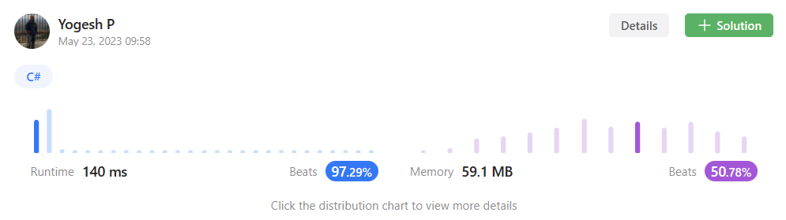

# Simplest solution | C# | +97% efficient

**Author:** Baymax_
**Votes:** 38
**Link:** [https://leetcode.com/problems/kth-largest-element-in-a-stream/solutions/3554324/](https://leetcode.com/problems/kth-largest-element-in-a-stream/solutions/3554324/)

---



# Intuition
<!-- Describe your first thoughts on how to solve this problem. -->
Since we have a data-stream incoming and we need to be able to tell the Kth largest element at all times, we can only maintain/store K largest elements and discard the rest. Also since we need to identify the Kth largest element easily, we need a pre-sorted collection.

# Approach
Here, we'll use a Priority Queue to store only K largest elements and discard the rest. The C# Priority Queue has default behaviour of considering the 'lower priority vlaue' as highest priority and hence it'll be the first to be dequeued.

Applying this, we'll have lower elements in the front and larger elements in the back of the queue. So if we maintain only K elements always in the queue, the element in the front of the queue will be the Kth largest element.


# Complexity
- Time complexity:
<!-- Add your time complexity here, e.g. $$O(n)$$ -->
O(N*LogN) - inserting N elements with each element taking O(LogN) time.

- Space complexity:
<!-- Add your space complexity here, e.g. $$O(n)$$ -->
O(1) - even though we use a Priority Queue, the memory we'll use is to store maximum of (K + 1) elements at any given time.

## Please upvote if you like the approach

# Code
```
public class KthLargest 
{
    //we'll always maintain only top k largest elements in this queue
    //and queue will have elements in increasing order, so we can get Kth largest element by simply peeking the queue
    PriorityQueue<int, int> pq;

    //to store 'k'
    int k;
    

    public KthLargest(int k, int[] nums) {
        this.k = k;
        pq = new PriorityQueue<int, int>();

        foreach (int num in nums)
        {
            Add(num);
        }
    }
    
    public int Add(int val) {
        //least element/value will have high priority and hence it'll be the first to be removed
        //higher valued elements will be at the end of queue
        pq.Enqueue(val, val);

        //maintain only k elements
        //this can be either a 'while' or a simple 'if' block, as it runs only once
        while (pq.Count > k)
        {
            pq.Dequeue();
        }

        return pq.Peek();
    }
}
```

## Please upvote if you like the approach

