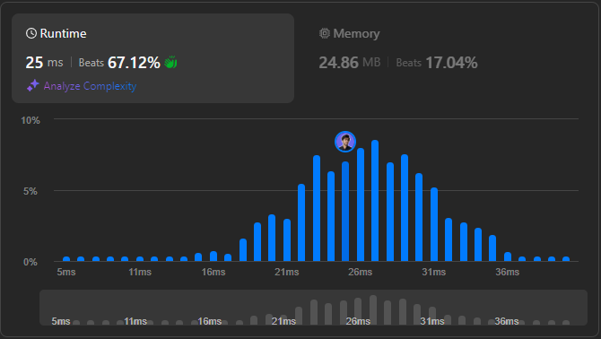

# 🌟 Step-by-Step Guide to Solving Kth Largest Element in Any Language 🔥💯

**Author:** withaarzoo
**Votes:** 24
**Link:** [https://leetcode.com/problems/kth-largest-element-in-a-stream/solutions/5624200/](https://leetcode.com/problems/kth-largest-element-in-a-stream/solutions/5624200/)

---


Explore a collection of solutions to LeetCode problems in multiple programming languages. Each solution includes a detailed explanation and step-by-step approach to solving the problem efficiently. Whether you're a beginner looking to learn or an experienced coder seeking optimized solutions, this repository aims to provide clear and insightful approaches to tackling challenging LeetCode problems.

### **Access daily LeetCode Solutions Repo :** [click here](https://github.com/withaarzoo/LeetCode-Solutions)

---



# Intuition
The problem requires us to find the k-th largest element in a continuously updating stream of integers. The key observation is that we don't need to sort the entire array every time we add a new element. Instead, we can maintain a small set of the k largest elements and quickly retrieve the smallest among them, which will be the k-th largest in the stream.

# Approach
To efficiently solve this problem, we can use a min-heap (priority queue) with a fixed size of `k`. The heap will store the k largest elements seen so far, with the smallest of these at the root of the heap. When a new element is added:
1. If the heap has fewer than `k` elements, add the new element.
2. If the heap already has `k` elements and the new element is larger than the root, replace the root with the new element.
3. The root of the heap will always be the k-th largest element.

# Complexity
- **Time complexity:**  
  Each insertion into the heap takes `O(log k)` time. Since there are `n` elements in total, the time complexity is `O(n log k)`.

- **Space complexity:**  
  The space complexity is `O(k)` because we store at most `k` elements in the heap.

# Code
```C++ []
#include <queue>
#include <vector>

class KthLargest {
public:
    KthLargest(int k, std::vector<int>& nums) : k(k) {
        for (int num : nums) {
            add(num);
        }
    }

    int add(int val) {
        if (minHeap.size() < k) {
            minHeap.push(val);
        } else if (val > minHeap.top()) {
            minHeap.pop();
            minHeap.push(val);
        }
        return minHeap.top();
    }

private:
    int k;
    std::priority_queue<int, std::vector<int>, std::greater<int>> minHeap;
};

```
```Java []
import java.util.PriorityQueue;

class KthLargest {
    private int k;
    private PriorityQueue<Integer> minHeap;

    public KthLargest(int k, int[] nums) {
        this.k = k;
        this.minHeap = new PriorityQueue<>(k);
        for (int num : nums) {
            add(num);
        }
    }

    public int add(int val) {
        if (minHeap.size() < k) {
            minHeap.offer(val);
        } else if (val > minHeap.peek()) {
            minHeap.poll();
            minHeap.offer(val);
        }
        return minHeap.peek();
    }
}

```
```JavaScript []
class KthLargest {
    constructor(k, nums) {
        this.k = k;
        this.minHeap = new MinPriorityQueue();
        for (let num of nums) {
            this.add(num);
        }
    }

    add(val) {
        if (this.minHeap.size() < this.k) {
            this.minHeap.enqueue(val);
        } else if (val > this.minHeap.front().element) {
            this.minHeap.dequeue();
            this.minHeap.enqueue(val);
        }
        return this.minHeap.front().element;
    }
}

```
```Python []
import heapq

class KthLargest:

    def __init__(self, k: int, nums: List[int]):
        self.k = k
        self.minHeap = []
        for num in nums:
            self.add(num)

    def add(self, val: int) -> int:
        if len(self.minHeap) < self.k:
            heapq.heappush(self.minHeap, val)
        elif val > self.minHeap[0]:
            heapq.heapreplace(self.minHeap, val)
        return self.minHeap[0]

```
```Go []
package main

import "container/heap"

type KthLargest struct {
    k int
    minHeap *IntHeap
}

func Constructor(k int, nums []int) KthLargest {
    minHeap := &IntHeap{}
    heap.Init(minHeap)
    kthLargest := KthLargest{k: k, minHeap: minHeap}
    for _, num := range nums {
        kthLargest.Add(num)
    }
    return kthLargest
}

func (this *KthLargest) Add(val int) int {
    if this.minHeap.Len() < this.k {
        heap.Push(this.minHeap, val)
    } else if val > (*this.minHeap)[0] {
        heap.Pop(this.minHeap)
        heap.Push(this.minHeap, val)
    }
    return (*this.minHeap)[0]
}

// IntHeap is a min-heap of ints.
type IntHeap []int

func (h IntHeap) Len() int           { return len(h) }
func (h IntHeap) Less(i, j int) bool { return h[i] < h[j] }
func (h IntHeap) Swap(i, j int)      { h[i], h[j] = h[j], h[i] }

func (h *IntHeap) Push(x interface{}) {
    *h = append(*h, x.(int))
}

func (h *IntHeap) Pop() interface{} {
    old := *h
    n := len(old)
    x := old[n-1]
    *h = old[0 : n-1]
    return x
}

```


# Step-by-Step Detailed Explanation

1. **Initialization:**
   - We initialize the class with `k` and the initial list `nums`.
   - We maintain a min-heap (using a priority queue) of size `k`.

2. **Add Method:**
   - If the current heap size is less than `k`, we simply add the new value to the heap.
   - If the heap is full and the new value is greater than the smallest value in the heap, we remove the smallest value (the root of the heap) and add the new value.
   - The root of the heap is always the k-th largest element.

3. **Heap Operations:**
   - `heapq.heappush()` in Python or `heap.Push()` in Go adds a new element to the heap while maintaining the heap property.
   - `heapq.heapreplace()` in Python or `heap.Pop()` followed by `heap.Push()` in Go replaces the smallest element in the heap, ensuring the heap size remains constant at `k`.

---


