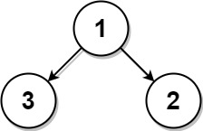
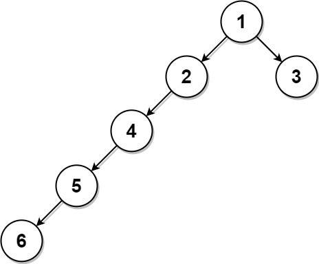

# [742. Closest Leaf in a Binary Tree](https://leetcode.com/problems/closest-leaf-in-a-binary-tree/)

| Category | Difficulty | Likes | Dislikes |
| :------: | :--------: | :---: | :------: |
| Algorithms | Medium | 887 | 189 |

**Tags:** [`tree`](https://leetcode.com/tag/tree), [`depth-first-search`](https://leetcode.com/tag/depth-first-search), [`breadth-first-search`](https://leetcode.com/tag/breadth-first-search), [`binary-tree`](https://leetcode.com/tag/binary-tree)

**Companies:** `linkedin`, `databricks`, `amazon`

## Description

Given the `root` of a binary tree where every node has **a unique value** and a target integer `k`, return *the value of the **nearest leaf node** to the target *`k`* in the tree*.

**Nearest to a leaf** means the least number of edges traveled on the binary tree to reach any leaf of the tree. Also, a node is called a leaf if it has no children.

 

**Example 1:**


```

Input: root = [1,3,2], k = 1
Output: 2
Explanation: Either 2 or 3 is the nearest leaf node to the target of 1.

```

**Example 2:**


```

Input: root = [1], k = 1
Output: 1
Explanation: The nearest leaf node is the root node itself.

```

**Example 3:**


```

Input: root = [1,2,3,4,null,null,null,5,null,6], k = 2
Output: 3
Explanation: The leaf node with value 3 (and not the leaf node with value 6) is nearest to the node with value 2.

```

 

**Constraints:**

	- The number of nodes in the tree is in the range `[1, 1000]`.

	- `1 <= Node.val <= 1000`

	- All the values of the tree are **unique**.

	- There exist some node in the tree where `Node.val == k`.

---

**Links:** [Submissions](https://leetcode.com/problems/closest-leaf-in-a-binary-tree/) | [Solutions](https://leetcode.com/problems/closest-leaf-in-a-binary-tree/)
