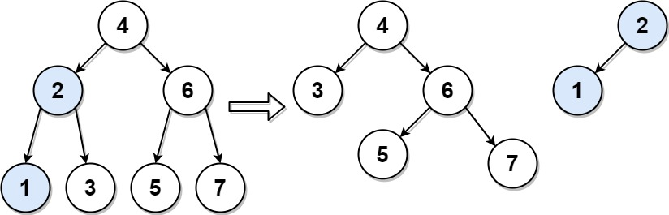

# [776. Split BST](https://leetcode.com/problems/split-bst/)

| Category | Difficulty | Likes | Dislikes |
| :------: | :--------: | :---: | :------: |
| Algorithms | Medium | 1091 | 105 |

**Tags:** [`tree`](https://leetcode.com/tag/tree), [`binary-search-tree`](https://leetcode.com/tag/binary-search-tree), [`recursion`](https://leetcode.com/tag/recursion), [`binary-tree`](https://leetcode.com/tag/binary-tree)

**Companies:** `amazon`, `coupang`

## Description

Given the `root` of a binary search tree (BST) and an integer `target`, split the tree into two subtrees where the first subtree has nodes that are all smaller or equal to the target value, while the second subtree has all nodes that are greater than the target value. It is not necessarily the case that the tree contains a node with the value `target`.

Additionally, most of the structure of the original tree should remain. Formally, for any child `c` with parent `p` in the original tree, if they are both in the same subtree after the split, then node `c` should still have the parent `p`.

Return *an array of the two roots of the two subtrees in order*.

 

**Example 1:**


```

Input: root = [4,2,6,1,3,5,7], target = 2
Output: [[2,1],[4,3,6,null,null,5,7]]

```

**Example 2:**

```

Input: root = [1], target = 1
Output: [[1],[]]

```

 

**Constraints:**

	- The number of nodes in the tree is in the range `[1, 50]`.

	- `0 <= Node.val, target <= 1000`

---

**Links:** [Submissions](https://leetcode.com/problems/split-bst/) | [Solutions](https://leetcode.com/problems/split-bst/)
