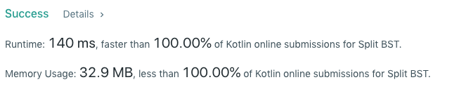

# Kotlin - 140 ms - Recurse based on the relation between the root value and the target value

**Author:** ed-karabinus
**Votes:** 1
**Link:** [https://leetcode.com/problems/split-bst/solutions/621959/](https://leetcode.com/problems/split-bst/solutions/621959/)

---


```
class Solution {
    fun splitBST(root: TreeNode?, V: Int): Array<TreeNode?> {
        if (root == null) {
            return arrayOf(null, null)
        }   
        val rootVal = root.`val`
        if (rootVal <= V) {
            val splitSubtree = splitBST(root.right, V)
            root.right = splitSubtree.get(0)
            return arrayOf(root, splitSubtree.get(1))
        } else {
            val splitSubtree = splitBST(root.left, V)
            root.left = splitSubtree.get(1)
            return arrayOf(splitSubtree.get(0), root)
        }
    }
}
```