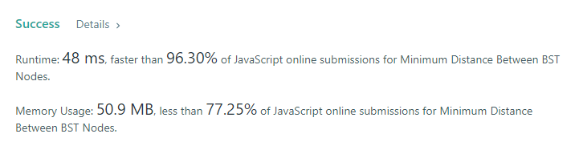

# 💢☠💫Easiest👾Faster✅💯 Lesser🧠 🎯 C++✅Python3🐍✅Java✅C✅Python🐍✅C#✅💥🔥💫Explained☠💥🔥 Beats 💯

**Author:** Edwards310
**Votes:** 3
**Link:** [https://leetcode.com/problems/minimum-distance-between-bst-nodes/solutions/5559161/](https://leetcode.com/problems/minimum-distance-between-bst-nodes/solutions/5559161/)

---

# Intuition




```javascript []
/**
 * Definition for a binary tree node.
 * function TreeNode(val, left, right) {
 *     this.val = (val===undefined ? 0 : val)
 *     this.left = (left===undefined ? null : left)
 *     this.right = (right===undefined ? null : right)
 * }
 */
/**
 * @param {TreeNode} root
 * @return {number}
 */
var minDiffInBST = function(root) {
    var ans = Number.MAX_VALUE
    var prev = Number.MAX_VALUE
    const inorder = (root) => {
        if(!root)
            return
        inorder(root.right)
        if(ans > prev - root.val)
            ans = prev - root.val
        prev = root.val
        inorder(root.left)
        return
    }
    inorder(root)
    return ans
};
```
```Python3 []
# Definition for a binary tree node.
# class TreeNode:
#     def __init__(self, val=0, left=None, right=None):
#         self.val = val
#         self.left = left
#         self.right = right
class Solution:
    def minDiffInBST(self, root: Optional[TreeNode]) -> int:
        res = []
        def inorder(root):
            if not root:
                return
            inorder(root.left)
            res.append(root.val)
            inorder(root.right)
            return
        
        ans = 1000000
        inorder(root)
        for i in range(1, len(res)):
            value = res[i] - res[i - 1]
            ans = min(ans, value)
            
        return ans
```
```C++ []
// Start Of Anuj Bhati aka Edwards310's Template...
#include <bits/stdc++.h>
using namespace std;

#define FOR(a, b, c) for (int a = b; a < c; a++)
#define FOR1(a, b, c) for (int a = b; a <= c; ++a)
#define Rep(i, n) FOR(i, 0, n)

// end of Anuj Bhati's aka Edwards310's Template
/**
 * Definition for a binary tree node.
 * struct TreeNode {
 *     int val;
 *     TreeNode *left;
 *     TreeNode *right;
 *     TreeNode() : val(0), left(nullptr), right(nullptr) {}
 *     TreeNode(int x) : val(x), left(nullptr), right(nullptr) {}
 *     TreeNode(int x, TreeNode *left, TreeNode *right) : val(x), left(left), right(right) {}
 * };
 */
class Solution {
private:
    void inorder(TreeNode* root, vi& in){
        if(!root)
            return;
        inorder(root->left, in);
        in.pb(root->val);
        inorder(root->right, in);
        return;
    }
public:
    int minDiffInBST(TreeNode* root) {
        vi in;
        inorder(root, in);
        int ans = INT_MAX;
        FOR(i, 1, in.size()){
            int value = in[i] - in[i - 1];
            if(value < ans)
                ans = value;
        }
        return ans;
    }
};
```
```Java []
/**
 * Definition for a binary tree node.
 * public class TreeNode {
 *     int val;
 *     TreeNode left;
 *     TreeNode right;
 *     TreeNode() {}
 *     TreeNode(int val) { this.val = val; }
 *     TreeNode(int val, TreeNode left, TreeNode right) {
 *         this.val = val;
 *         this.left = left;
 *         this.right = right;
 *     }
 * }
 */
class Solution {
    TreeNode prev = null;
    int ans = Integer.MAX_VALUE;
    private void inorder(TreeNode root){
        if(root == null)
            return ;
        inorder(root.left);
        if(prev != null)
            ans = Math.min(ans, root.val - prev.val);
        prev = root;
        inorder(root.right);
        return ;
            
    }
    public int minDiffInBST(TreeNode root) {
        inorder(root);
        return ans;
    }
}
```
```C []
/**
 * Definition for a binary tree node.
 * struct TreeNode {
 *     int val;
 *     struct TreeNode *left;
 *     struct TreeNode *right;
 * };
 */
void inorder(struct TreeNode* root, struct TreeNode** prev, int* ans){
    if(!root)
        return;
    inorder(root->left, prev, ans);
    if(*(prev))
        *ans = fmin(*ans , fabs(root->val - (*prev)->val));
    *prev = root;
    inorder(root->right, prev, ans);
    return;
    
}

int minDiffInBST(struct TreeNode* root) {
    struct TreeNode* prev = NULL;
    int ans = INT_MAX;
    inorder(root, &prev, &ans);
    return ans;
}
```
```Python []
# Definition for a binary tree node.
# class TreeNode(object):
#     def __init__(self, val=0, left=None, right=None):
#         self.val = val
#         self.left = left
#         self.right = right
class Solution(object):
    def __init__(self):
        self.prev = None
        self.res = float('inf')
    def minDiffInBST(self, root):
        """
        :type root: TreeNode
        :rtype: int
        """
        if not root:
            return

        self.minDiffInBST(root.left)

        if self.prev is not None:
            self.res = min(self.res, abs(self.prev - root.val))
        self.prev = root.val

        self.minDiffInBST(root.right)

        return self.res

```
```C# []
/**
 * Definition for a binary tree node.
 * public class TreeNode {
 *     public int val;
 *     public TreeNode left;
 *     public TreeNode right;
 *     public TreeNode(int val=0, TreeNode left=null, TreeNode right=null) {
 *         this.val = val;
 *         this.left = left;
 *         this.right = right;
 *     }
 * }
 */
public class Solution {
    TreeNode prev = null;
    int ans = Int32.MaxValue;
    private void inorder(TreeNode root){
        if(root == null)
            return ;
        inorder(root.left);
        if(prev != null)
            ans = Math.Min(ans, root.val - prev.val);
        prev = root;
        inorder(root.right);
        return ;
            
    }
    public int MinDiffInBST(TreeNode root) {
        inorder(root);
        return ans;
    }
}
```
<!-- Describe your first thoughts on how to solve this problem. -->

# Approach
<!-- Describe your approach to solving the problem. -->

# Complexity
- Time complexity:
<!-- Add your time complexity here, e.g. $$O(n)$$ -->
     O(n)
- Space complexity:
<!-- Add your space complexity here, e.g. $$O(n)$$ -->
     O(1)
# Code
```
/**
 * Definition for a binary tree node.
 * function TreeNode(val, left, right) {
 *     this.val = (val===undefined ? 0 : val)
 *     this.left = (left===undefined ? null : left)
 *     this.right = (right===undefined ? null : right)
 * }
 */
/**
 * @param {TreeNode} root
 * @return {number}
 */
var minDiffInBST = function(root) {
    var ans = Number.MAX_VALUE
    var prev = Number.MAX_VALUE
    const inorder = (root) => {
        if(!root)
            return
        inorder(root.right)
        if(ans > prev - root.val)
            ans = prev - root.val
        prev = root.val
        inorder(root.left)
        return
    }
    inorder(root)
    return ans
};
```

