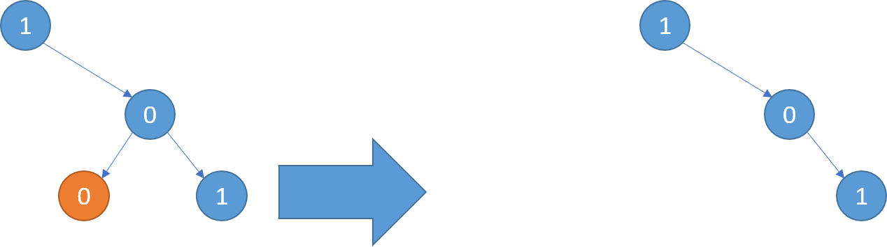
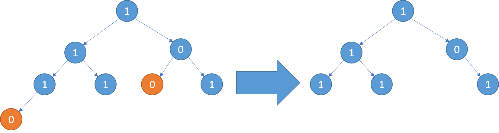

# [814. Binary Tree Pruning](https://leetcode.com/problems/binary-tree-pruning/)

| Category | Difficulty | Likes | Dislikes |
| :------: | :--------: | :---: | :------: |
| Algorithms | Medium | 4645 | 121 |

**Tags:** [`tree`](https://leetcode.com/tag/tree), [`depth-first-search`](https://leetcode.com/tag/depth-first-search), [`binary-tree`](https://leetcode.com/tag/binary-tree)

**Companies:** `facebook`, `amazon`, `hulu`

## Description

Given the `root` of a binary tree, return *the same tree where every subtree (of the given tree) not containing a *`1`* has been removed*.

A subtree of a node `node` is `node` plus every node that is a descendant of `node`.

 

**Example 1:**


```

Input: root = [1,null,0,0,1]
Output: [1,null,0,null,1]
Explanation: 
Only the red nodes satisfy the property &quot;every subtree not containing a 1&quot;.
The diagram on the right represents the answer.

```

**Example 2:**


```

Input: root = [1,0,1,0,0,0,1]
Output: [1,null,1,null,1]

```

**Example 3:**


```

Input: root = [1,1,0,1,1,0,1,0]
Output: [1,1,0,1,1,null,1]

```

 

**Constraints:**

	- The number of nodes in the tree is in the range `[1, 200]`.

	- `Node.val` is either `0` or `1`.

---

**Links:** [Submissions](https://leetcode.com/problems/binary-tree-pruning/) | [Solutions](https://leetcode.com/problems/binary-tree-pruning/)
