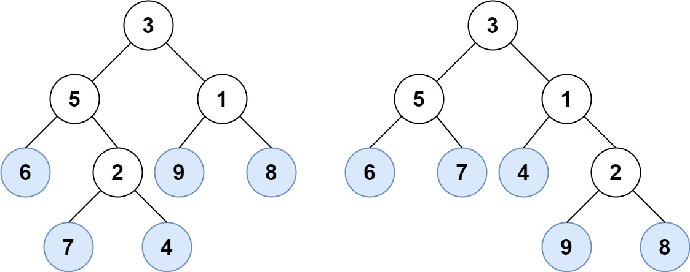
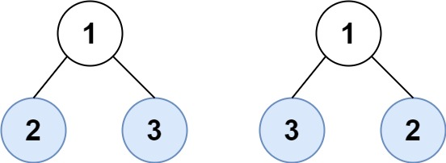

# [872. Leaf-Similar Trees](https://leetcode.com/problems/leaf-similar-trees/)

| Category | Difficulty | Likes | Dislikes |
| :------: | :--------: | :---: | :------: |
| Algorithms | Easy | 4335 | 124 |

**Tags:** [`tree`](https://leetcode.com/tag/tree), [`depth-first-search`](https://leetcode.com/tag/depth-first-search), [`binary-tree`](https://leetcode.com/tag/binary-tree)

**Companies:** `google`, `amazon`, `facebook`, `microsoft`, `snowflake`

## Description

Consider all the leaves of a binary tree, from left to right order, the values of those leaves form a **leaf value sequence***.*


For example, in the given tree above, the leaf value sequence is `(6, 7, 4, 9, 8)`.

Two binary trees are considered *leaf-similar* if their leaf value sequence is the same.

Return `true` if and only if the two given trees with head nodes `root1` and `root2` are leaf-similar.

 

**Example 1:**


```

Input: root1 = [3,5,1,6,2,9,8,null,null,7,4], root2 = [3,5,1,6,7,4,2,null,null,null,null,null,null,9,8]
Output: true

```

**Example 2:**


```

Input: root1 = [1,2,3], root2 = [1,3,2]
Output: false

```

 

**Constraints:**

	- The number of nodes in each tree will be in the range `[1, 200]`.

	- Both of the given trees will have values in the range `[0, 200]`.

---

**Links:** [Submissions](https://leetcode.com/problems/leaf-similar-trees/) | [Solutions](https://leetcode.com/problems/leaf-similar-trees/)
