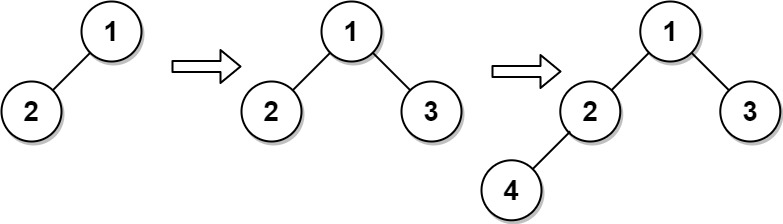

# [919. Complete Binary Tree Inserter](https://leetcode.com/problems/complete-binary-tree-inserter/)

| Category | Difficulty | Likes | Dislikes |
| :------: | :--------: | :---: | :------: |
| Algorithms | Medium | 1149 | 120 |

**Tags:** [`tree`](https://leetcode.com/tag/tree), [`breadth-first-search`](https://leetcode.com/tag/breadth-first-search), [`design`](https://leetcode.com/tag/design), [`binary-tree`](https://leetcode.com/tag/binary-tree)

**Companies:** `facebook`, `amazon`, `uber`, `google`

## Description

A **complete binary tree** is a binary tree in which every level, except possibly the last, is completely filled, and all nodes are as far left as possible.

Design an algorithm to insert a new node to a complete binary tree keeping it complete after the insertion.

Implement the `CBTInserter` class:

	- `CBTInserter(TreeNode root)` Initializes the data structure with the `root` of the complete binary tree.

	- `int insert(int v)` Inserts a `TreeNode` into the tree with value `Node.val == val` so that the tree remains complete, and returns the value of the parent of the inserted `TreeNode`.

	- `TreeNode get_root()` Returns the root node of the tree.

 

**Example 1:**


```

Input
[&quot;CBTInserter&quot;, &quot;insert&quot;, &quot;insert&quot;, &quot;get_root&quot;]
[[[1, 2]], [3], [4], []]
Output
[null, 1, 2, [1, 2, 3, 4]]

Explanation
CBTInserter cBTInserter = new CBTInserter([1, 2]);
cBTInserter.insert(3);  // return 1
cBTInserter.insert(4);  // return 2
cBTInserter.get_root(); // return [1, 2, 3, 4]

```

 

**Constraints:**

	- The number of nodes in the tree will be in the range `[1, 1000]`.

	- `0 <= Node.val <= 5000`

	- `root` is a complete binary tree.

	- `0 <= val <= 5000`

	- At most `10^4` calls will be made to `insert` and `get_root`.

---

**Links:** [Submissions](https://leetcode.com/problems/complete-binary-tree-inserter/) | [Solutions](https://leetcode.com/problems/complete-binary-tree-inserter/)
