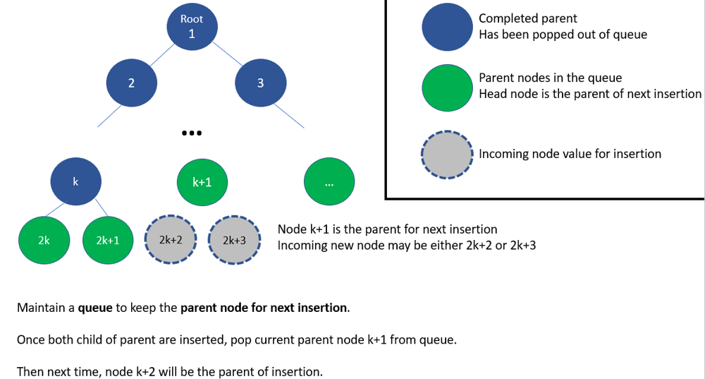

# Python O(n) init O(1) insert by queue. 80%+ [w/ Diagram]

**Author:** brianchiang_tw
**Votes:** 17
**Link:** [https://leetcode.com/problems/complete-binary-tree-inserter/solutions/534002/](https://leetcode.com/problems/complete-binary-tree-inserter/solutions/534002/)

---

Python O(n) init O(1) insert by queue.

---

**Hint**:

Utilize the nature of **numbering** in complete binary tree
Number each node, start from root as 1, 2, 3, ..., and so on.

For each node with of number *k*,
node with ( 2*k* ) is left child
node with ( 2*k* + 1 ) is right child

Maintin a **queue** (i.e., First-in First-out ), to keep the **parent for next insertion** operation on-demand.

---

**Diagram** & **Abstract model**:



---
**Implementation**:
```
from collections import deque

class CBTInserter:

    
    def __init__(self, root: TreeNode):
        
        self.root = root
        
        self.parent_keeper = deque([root])

        while True:
            
            cur = self.parent_keeper[0]
            
            if cur:
                
                if cur.left:
                    
                    self.parent_keeper.append( cur.left )
                    
                    if cur.right:
                        
                        self.parent_keeper.append( cur.right )
                        
                        # cur is completed with two child, pop out
                        self.parent_keeper.popleft()
                    
                    else:
                        # parent of next insertion is found, stop
                        break
                
                else:
                    # parent of next insertion is found, stop
                    break
        
        

    def insert(self, v: int) -> int:
        
        parent = self.parent_keeper[0]
        
		# Insert with leftward compact, to meet the definition of complete binary tree
		
        if not parent.left:
            parent.left = TreeNode( v )
            self.parent_keeper.append( parent.left )
        else:
            parent.right = TreeNode( v )
            self.parent_keeper.append( parent.right )
            
            # current parent is completed with two child now, pop parent from parent keeper on the head
            self.parent_keeper.popleft()
            
        return parent.val
        

    def get_root(self) -> TreeNode:
        
        return self.root
```

---

Related leetcode challenge:

[Leetcode #958 Check Completeness of a Binary Tree](https://leetcode.com/problems/check-completeness-of-a-binary-tree/)

[Leetcode #222 Count Complete Tree Nodes](https://leetcode.com/problems/count-complete-tree-nodes/)

---

Reference:

[1] [Wiki: Complete binary tree](https://en.wikipedia.org/wiki/Binary_tree#Types_of_binary_trees)

[2] [GfG: Complete binary tree](https://bit.ly/3aFrrYQ)