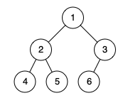
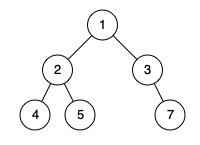

# [958. Check Completeness of a Binary Tree](https://leetcode.com/problems/check-completeness-of-a-binary-tree/)

| Category | Difficulty | Likes | Dislikes |
| :------: | :--------: | :---: | :------: |
| Algorithms | Medium | 4506 | 62 |

**Tags:** [`tree`](https://leetcode.com/tag/tree), [`breadth-first-search`](https://leetcode.com/tag/breadth-first-search), [`binary-tree`](https://leetcode.com/tag/binary-tree)

**Companies:** `facebook`, `microsoft`, `amazon`

## Description

Given the `root` of a binary tree, determine if it is a *complete binary tree*.

In a **complete binary tree**, every level, except possibly the last, is completely filled, and all nodes in the last level are as far left as possible. It can have between `1` and `2^h` nodes inclusive at the last level `h`.

 

**Example 1:**


```

Input: root = [1,2,3,4,5,6]
Output: true
Explanation: Every level before the last is full (ie. levels with node-values {1} and {2, 3}), and all nodes in the last level ({4, 5, 6}) are as far left as possible.

```

**Example 2:**


```

Input: root = [1,2,3,4,5,null,7]
Output: false
Explanation: The node with value 7 isn&#39;t as far left as possible.

```

 

**Constraints:**

	- The number of nodes in the tree is in the range `[1, 100]`.

	- `1 <= Node.val <= 1000`

---

**Links:** [Submissions](https://leetcode.com/problems/check-completeness-of-a-binary-tree/) | [Solutions](https://leetcode.com/problems/check-completeness-of-a-binary-tree/)
