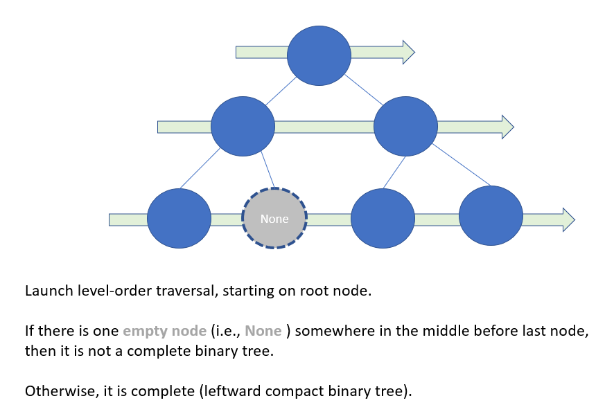

# Python/JS/Java/Go/C++ O(n) by level-order traversal.  [w/ Diagram ] 有中文BFS演算法框架解析文章

**Author:** brianchiang_tw
**Votes:** 75
**Link:** [https://leetcode.com/problems/check-completeness-of-a-binary-tree/solutions/533798/](https://leetcode.com/problems/check-completeness-of-a-binary-tree/solutions/533798/)

---

[BFS\u6F14\u7B97\u6CD5\u6846\u67B6\u89E3\u8AAA\u6587\u7AE0](https://vocus.cc/article/66e6e33efd89780001a55a6d)

O(n) by level-order traversal.

---

**Hint**:

Complete binary tree is a leftward compact tree.

Launch **level-order-traersal** (or **BFS** if we see binary tree as a *single source graph on root* )

If there is an **empty node** (i.e. **None**) somewhere **in the middle** before last node,
then it is Not a *[complete binary tree](https://en.wikipedia.org/wiki/Binary_tree#Types_of_binary_trees)*, thus return False.

Otherwise, it is complete and return True.

---

**Diagram** and **abstract model**:




---
**Implementation**:

Python:

```
from collections import deque

class Solution:
    def isCompleteTree(self, root: TreeNode) -> bool:
        
        
        traversal_queue = deque( [ root ] )
        prev_node = root
        
        
        # Launch Level-order traversal
        
        while traversal_queue:
            
            cur_node = traversal_queue.popleft()
            
            if cur_node:
                
                if not prev_node:
                    # Empty node in the middle means this is not a complete binary tree ( not left-compact)
                    return False
                
                traversal_queue.append( cur_node.left )
                traversal_queue.append( cur_node.right )
            
            # update previous node
            prev_node = cur_node
            
        return True
```

---

Java:

```
class Solution {
    public boolean isCompleteTree(TreeNode root) {
        
        Queue<TreeNode> queue = new LinkedList<TreeNode>();
        queue.offer( root );
        
        TreeNode prevNode = root;
        
        // Launch level-order traversal
        while( queue.size() > 0 ){
            
            TreeNode curNode = queue.poll();
            
            if( curNode != null ){
                
                if( prevNode == null ){
                    // Empty node in the middle means this is not a complete binary tree ( not left-compact)
                    return false;
                }
                
                queue.offer( curNode.left );
                queue.offer( curNode.right );
            }
            // udpate previous node
            prevNode = curNode;
        }
        return true;
    }
}
```

---


Javascript:

```
var isCompleteTree = function(root) {
    
    // Initialization
    let traversal_queue = [root];
    let prevNode = root;
    
    // Launch level-order traversal
    while( traversal_queue.length ){
        
        let curNode = traversal_queue.shift();
        
        if( curNode != null )
        {
            if( prevNode == null ){
                // Empty in the middle means this is not a complete binary tree (not left-compact)
                return false;
            }    
            
            traversal_queue.push( curNode.left );
            traversal_queue.push( curNode.right );
        }
        
        // update previous node
        prevNode = curNode;
    }
    
    return true;
};
```

---

Go:

```
import (
    "container/list"
)

func isCompleteTree(root *TreeNode) bool {
    
    // Initialization
    traversalQ := list.New()
    traversalQ.PushBack( root )
    
    prevNode := root
    
    // Launch level-order traversal
    for traversalQ.Len() != 0 {
        
        queueHead := traversalQ.Front();
        traversalQ.Remove( queueHead )
        
        curNode := queueHead.Value.(*TreeNode)
        
        if( curNode != nil ){
            
            if( prevNode == nil){
                // Empty in the middle means this is not a complete binary tree (not left-compact)
                return false;
            }
            
            traversalQ.PushBack( curNode.Left )
            traversalQ.PushBack( curNode.Right )
        }
        
        // update previous node
        prevNode = curNode
    }
    
    return true;
}
```

---

C++

```
class Solution {
public:
    bool isCompleteTree(TreeNode* root) {
        
        std::queue< TreeNode* > traversalQ;
        traversalQ.push( root );
        TreeNode* prevNode = root;
        
        // Launch level-order traversal
        while( traversalQ.size() ){
            
            TreeNode* curNode = traversalQ.front();
            traversalQ.pop();
            
            if( curNode != nullptr ){
                
                if( prevNode == nullptr ){
                    // Empty in the middle means this is not a complete binary tree (not left-compact)
                    return false;
                }
                
                traversalQ.push( curNode->left );
                traversalQ.push( curNode->right );
            }
            
            // update previous node
            prevNode = curNode;
        }
        
        return true;
    }
};
```

---

Related leetcode challenge:

[Leetcode #102 Binary Tree Level Order Traversal](https://leetcode.com/problems/binary-tree-level-order-traversal/)

[Leetcode #107 Binary Tree Level Order Traversal II](https://leetcode.com/problems/binary-tree-level-order-traversal-ii/)

[Leetcode #222 Count Complete Tree Nodes](https://leetcode.com/problems/count-complete-tree-nodes/)

---

Reference:

[1] [Wiki: Complete binary tree](https://en.wikipedia.org/wiki/Binary_tree#Types_of_binary_trees)

[2] [GfG: Complete binary tree](https://bit.ly/3aFrrYQ)