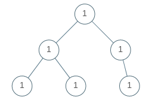
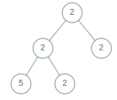

# [965. Univalued Binary Tree](https://leetcode.com/problems/univalued-binary-tree/)

| Category | Difficulty | Likes | Dislikes |
| :------: | :--------: | :---: | :------: |
| Algorithms | Easy | 1971 | 68 |

**Tags:** [`tree`](https://leetcode.com/tag/tree), [`depth-first-search`](https://leetcode.com/tag/depth-first-search), [`breadth-first-search`](https://leetcode.com/tag/breadth-first-search), [`binary-tree`](https://leetcode.com/tag/binary-tree)

**Companies:** `box`, `google`, `twilio`

## Description

A binary tree is **uni-valued** if every node in the tree has the same value.

Given the `root` of a binary tree, return `true`* if the given tree is **uni-valued**, or *`false`* otherwise.*

 

**Example 1:**


```

Input: root = [1,1,1,1,1,null,1]
Output: true

```

**Example 2:**


```

Input: root = [2,2,2,5,2]
Output: false

```

 

**Constraints:**

	- The number of nodes in the tree is in the range `[1, 100]`.

	- `0 <= Node.val < 100`

---

**Links:** [Submissions](https://leetcode.com/problems/univalued-binary-tree/) | [Solutions](https://leetcode.com/problems/univalued-binary-tree/)
