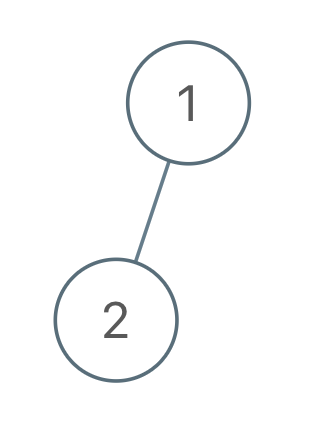
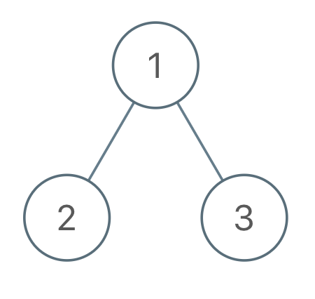

# [971. Flip Binary Tree To Match Preorder Traversal](https://leetcode.com/problems/flip-binary-tree-to-match-preorder-traversal/)

| Category | Difficulty | Likes | Dislikes |
| :------: | :--------: | :---: | :------: |
| Algorithms | Medium | 994 | 284 |

**Tags:** [`tree`](https://leetcode.com/tag/tree), [`depth-first-search`](https://leetcode.com/tag/depth-first-search), [`binary-tree`](https://leetcode.com/tag/binary-tree)


## Description

You are given the `root` of a binary tree with `n` nodes, where each node is uniquely assigned a value from `1` to `n`. You are also given a sequence of `n` values `voyage`, which is the **desired** **pre-order traversal** of the binary tree.

Any node in the binary tree can be **flipped** by swapping its left and right subtrees. For example, flipping node 1 will have the following effect:


Flip the **smallest** number of nodes so that the **pre-order traversal** of the tree **matches** `voyage`.

Return *a list of the values of all **flipped** nodes. You may return the answer in **any order**. If it is **impossible** to flip the nodes in the tree to make the pre-order traversal match *`voyage`*, return the list *`[-1]`.

 

**Example 1:**


```

Input: root = [1,2], voyage = [2,1]
Output: [-1]
Explanation: It is impossible to flip the nodes such that the pre-order traversal matches voyage.

```

**Example 2:**


```

Input: root = [1,2,3], voyage = [1,3,2]
Output: [1]
Explanation: Flipping node 1 swaps nodes 2 and 3, so the pre-order traversal matches voyage.
```

**Example 3:**


```

Input: root = [1,2,3], voyage = [1,2,3]
Output: []
Explanation: The tree&#39;s pre-order traversal already matches voyage, so no nodes need to be flipped.

```

 

**Constraints:**

	- The number of nodes in the tree is `n`.

	- `n == voyage.length`

	- `1 <= n <= 100`

	- `1 <= Node.val, voyage[i] <= n`

	- All the values in the tree are **unique**.

	- All the values in `voyage` are **unique**.

---

**Links:** [Submissions](https://leetcode.com/problems/flip-binary-tree-to-match-preorder-traversal/) | [Solutions](https://leetcode.com/problems/flip-binary-tree-to-match-preorder-traversal/)
