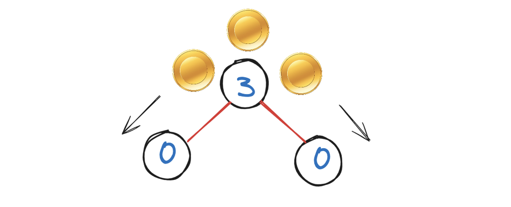
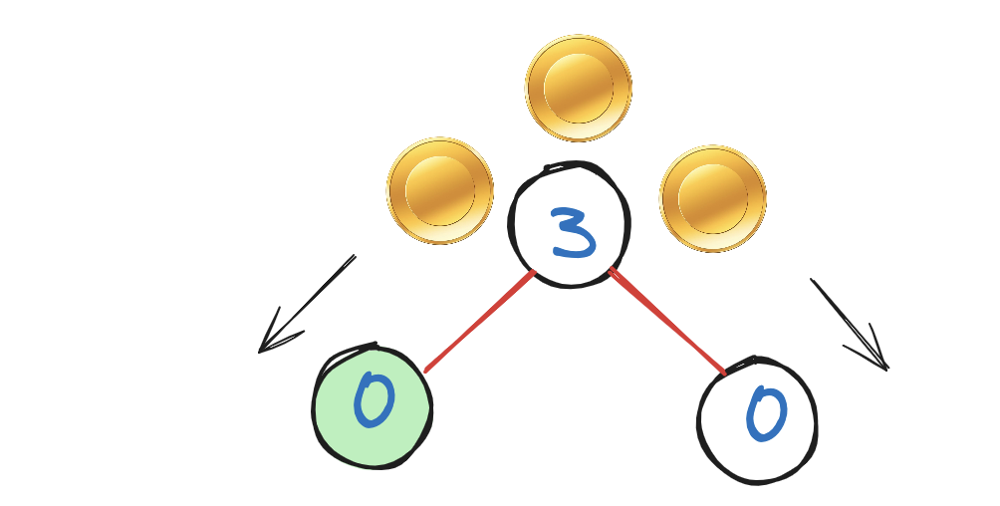
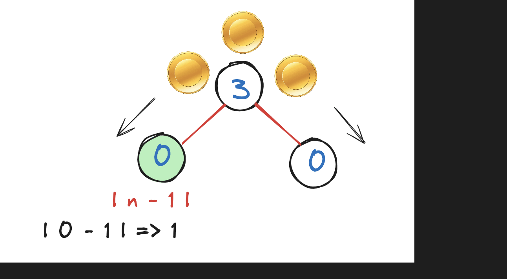
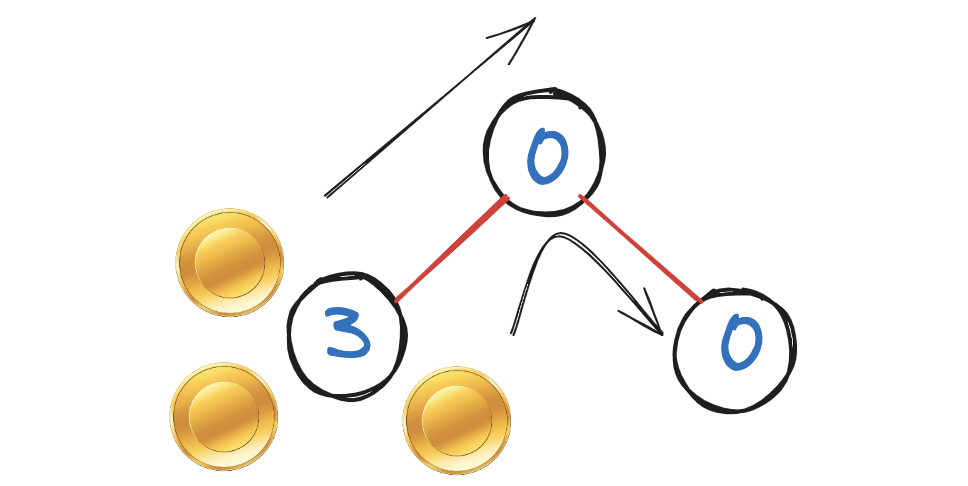
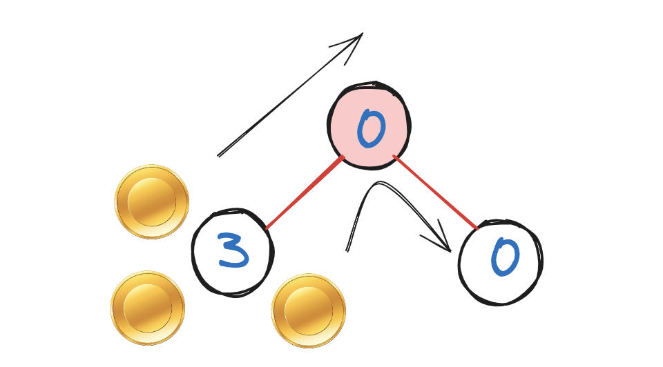
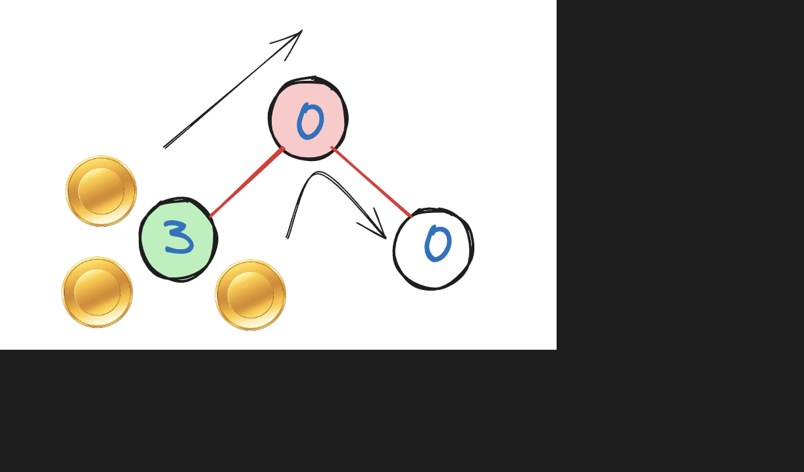
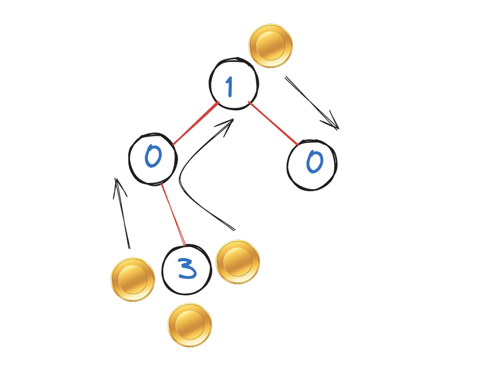
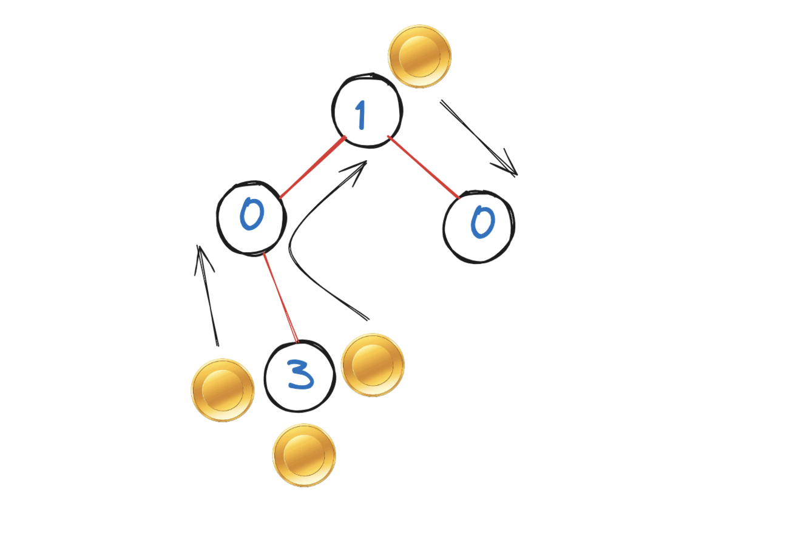

# Explanation As easy as you think

**Author:** hi-malik
**Votes:** 45
**Link:** [https://leetcode.com/problems/distribute-coins-in-binary-tree/solutions/5172546/](https://leetcode.com/problems/distribute-coins-in-binary-tree/solutions/5172546/)

---

How to Approach this question is,

First lets solve the very sub problem of this, will solve the one has the minimum dependency and that will be the leaf node, because it doesn't have any sort of its child. First will see, how to solve on leaf node, then will move to parent node.

Let's look at one example : 

If we talk about the **highlighted node**, so there are only **3 possiblities** either the number of coin has is **equals to one**, either it is **greater than one** either it is **less than one**.

So, if it has **one coin**, then how many number of moves we required, we requires **zero moves**. Because since it's the leaf node and it already has one, then we do need to do anything further.
**What if it has less number of coin then one?**
> Then it will have **zero no** of coins, instead of -ve numbers.

What if it has **zero number** of coins, then how many moves it requires so that it get one coin?
> It will only require one coin. As it get one coin from it's parents

What if it has value **greater then one**?
> So the answer is, it will take 2 moves, because it has 2 additional coins, to have that node 1 coin, it will move 2 of it's coin.

```
If we try to create a formula for this, it will be
| n - 1 |, mod of n - 1 and n is no of coin it has
```

Let's try to use this in current example : 


**`Let's look at another example, how to solve with the parent node`**
Let's look again at one example

So, the number of steps **parents node** `(highlighted in the image)` will require depends upon the number of steps it's **left** and **right** child will requires.
* So, how many steps it's left child requires is **2** to get **1**


* And the right child requires **1** step to get **1 coin**
* And if we add **`2 + 1 => 3`** shows that many number of steps we requires


As for the best example, let's try to understand this one more example


Here we have 3 coins in the leaf node, to get to it's parent node, how many coin it requires **2** now even to get to it's parent node and make it **1** how many coins it requires **1** and it will become **2** and this parent node will move the extra coin to it's child node, it will take **1** move. **`Let's understand visually,`**



Let's code it up : 
**`JAVA`**
```
class Solution {
    public int ans;
    public int distributeCoins(TreeNode root) {
        ans = 0;
        countSteps(root);
        return ans;
    }
    public int countSteps(TreeNode root) {
        if (root == null) return 0;
        int leftCoins = countSteps(root.left);
        int rightCoins = countSteps(root.right);
        ans += Math.abs(leftCoins) + Math.abs(rightCoins);
        return (root.val - 1) + leftCoins + rightCoins;
    }
}
```
**`C++`**
```
class Solution {
public:
    int ans;
    
    int distributeCoins(TreeNode* root) {
        ans = 0;
        countSteps(root);
        return ans;
    }
    
    int countSteps(TreeNode* root) {
        if (root == nullptr) return 0;
        int leftCoins = countSteps(root->left);
        int rightCoins = countSteps(root->right);
        ans += abs(leftCoins) + abs(rightCoins);
        return (root->val - 1) + leftCoins + rightCoins;
    }
};
```
**`PYTHON`**
```
# Definition for a binary tree node.
# class TreeNode:
#     def __init__(self, val=0, left=None, right=None):
#         self.val = val
#         self.left = left
#         self.right = right
class Solution:
    def distributeCoins(self, root: Optional[TreeNode]) -> int:
        self.ans = 0
        def countSteps(root):
            if(root == None):
                return 0
            leftCoins=countSteps(root.left)
            rightCoins=countSteps(root.right)
            self.ans=abs(leftCoins)+abs(rightCoins)
            return root.val+leftCoins+rightCoins-1
        countSteps(root)
        return self.ans
```

___
Complexity Analysis
___
* **Time Complexity :-** BigO(N)
* **Space Complexity :-** BigO(N)

Let 
\uD835\uDC5B
be the number of nodes in the tree.