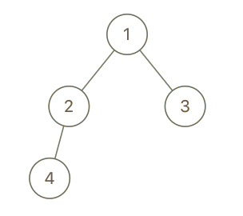
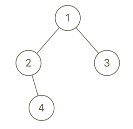

# [993. Cousins in Binary Tree](https://leetcode.com/problems/cousins-in-binary-tree/)

| Category | Difficulty | Likes | Dislikes |
| :------: | :--------: | :---: | :------: |
| Algorithms | Easy | 4289 | 232 |

**Tags:** [`tree`](https://leetcode.com/tag/tree), [`depth-first-search`](https://leetcode.com/tag/depth-first-search), [`breadth-first-search`](https://leetcode.com/tag/breadth-first-search), [`binary-tree`](https://leetcode.com/tag/binary-tree)

**Companies:** `amazon`, `facebook`, `google`, `tiktok`, `adobe`, `microsoft`, `bloomberg`

## Description

Given the `root` of a binary tree with unique values and the values of two different nodes of the tree `x` and `y`, return `true` *if the nodes corresponding to the values *`x`* and *`y`* in the tree are **cousins**, or *`false`* otherwise.*

Two nodes of a binary tree are **cousins** if they have the same depth with different parents.

Note that in a binary tree, the root node is at the depth `0`, and children of each depth `k` node are at the depth `k + 1`.

 

**Example 1:**


```

Input: root = [1,2,3,4], x = 4, y = 3
Output: false

```

**Example 2:**


```

Input: root = [1,2,3,null,4,null,5], x = 5, y = 4
Output: true

```

**Example 3:**


```

Input: root = [1,2,3,null,4], x = 2, y = 3
Output: false

```

 

**Constraints:**

	- The number of nodes in the tree is in the range `[2, 100]`.

	- `1 <= Node.val <= 100`

	- Each node has a **unique** value.

	- `x != y`

	- `x` and `y` are exist in the tree.

---

**Links:** [Submissions](https://leetcode.com/problems/cousins-in-binary-tree/) | [Solutions](https://leetcode.com/problems/cousins-in-binary-tree/)
