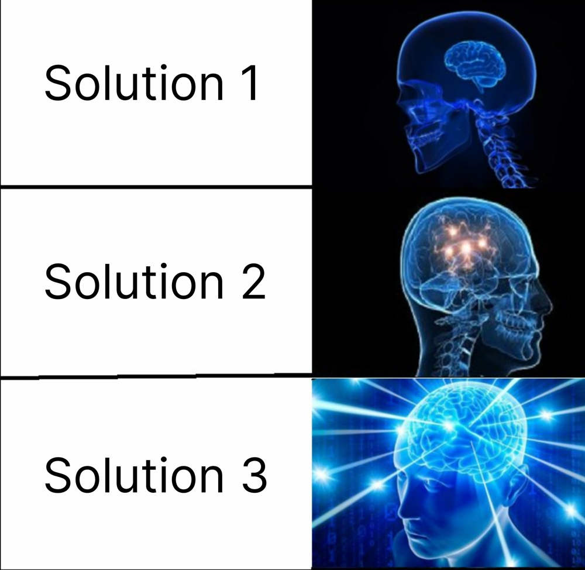

# 2 Approaches | Detailed C++ Explanation 🔥

**Author:** arsalAbbas
**Votes:** 4
**Link:** [https://leetcode.com/problems/maximum-binary-tree-ii/solutions/3975007/](https://leetcode.com/problems/maximum-binary-tree-ii/solutions/3975007/)

---

- Solutions go from **BEST TO WORST**
- If you like the solution please **UPVOTE**
# Solution 1 and 2
# Intuition
<!-- Describe your first thoughts on how to solve this problem. -->
- The value is being appended at the right of the array, so there will be no nodes to the right of the val node
- Since val is at the rightmost of the array, it will never be to the left of the original root
- If no value is found to be smaller than val then it will definitely be the rightmost node
- If a node is smaller than val then no node in that subtree will be greater than val, so we can directly attach this subtree to the left of val and attach val to the previous parent of the smaller node

# Approach
<!-- Describe your approach to solving the problem. -->
- Use a recursive apporoach to find the point where val is to be inserted
- Keep going right until a smaller element is found
- When a smaller element is found, detach it from it's parent and add temp as it's child.
- temp's left child will be the smaller element node and it will have no right child (refer intuition). Stop the recursion if the smaller node is found
- if no smaller node is found , val will be the rightmost node in the tree

# Complexity
- Time complexity: $$O(n)$$
    (we are going to each node at most once)
  -> Where n is the number of nodes
<!-- Add your time complexity here, e.g. $$O(n)$$ -->

- Space complexity: $$O(h)$$ 
(auxillary stack space)
  -> Where h is the height of the tree
<!-- Add your space complexity here, e.g. $$O(n)$$ -->

# Code : 1 (Refined)
```
/**
 * Definition for a binary tree node.
 * struct TreeNode {
 *     int val;
 *     TreeNode *left;
 *     TreeNode *right;
 *     TreeNode() : val(0), left(nullptr), right(nullptr) {}
 *     TreeNode(int x) : val(x), left(nullptr), right(nullptr) {}
 *     TreeNode(int x, TreeNode *left, TreeNode *right) : val(x), left(left), right(right) {}
 * };
 */
class Solution {
public:
    TreeNode* insertIntoMaxTree(TreeNode* root, int val) {
        if(!root){
            return new TreeNode(val);
        }
        else if(root->val<val){
            TreeNode* temp=new TreeNode(val);
            temp->left=root;
            return temp;
        }
        else{
            root->right=insertIntoMaxTree(root->right,val);
            return root;
        }
    }
};
```
# Code: 2 (Initial)
```
/**
 * Definition for a binary tree node.
 * struct TreeNode {
 *     int val;
 *     TreeNode *left;
 *     TreeNode *right;
 *     TreeNode() : val(0), left(nullptr), right(nullptr) {}
 *     TreeNode(int x) : val(x), left(nullptr), right(nullptr) {}
 *     TreeNode(int x, TreeNode *left, TreeNode *right) : val(x), left(left), right(right) {}
 * };
 */
class Solution {
public:
    TreeNode* insertIntoMaxTree(TreeNode* root, int val) {
        if(root->val <val){
            TreeNode* temp=new TreeNode(val);
            temp->left=root;
            root=temp;
        }
        else if(!(root->right)){
            root->right=new TreeNode(val);
            return root;
        }
        else if(root->right){
            if(root->right->val < val){
                TreeNode* temp=root->right;
                root->right=new TreeNode(val);
                root->right->left=temp;
            }
            else
                root->right=insertIntoMaxTree(root->right,val);
        }
        return root;
    }
};
```
# Solution 3
# Intuition
<!-- Describe your first thoughts on how to solve this problem. -->
- We are given the tree
- If somehow we can the generate the vector as in [Maximum-Binary-Tree](https://leetcode.com/problems/maximum-binary-tree/) we can simply attach val at the end and generate the maximum binary tree again

# Approach
<!-- Describe your approach to solving the problem. -->
- First generate the vector from the tree using a recursive approach
  -> First we add elements that are left to the root
  -> Then we add the root
  -> Then we add the elements that are right to the root
- Add the given val to the generated vector
- Generate the [Maximum-Binary-Tree](https://leetcode.com/problems/maximum-binary-tree/) 
# Code 3 (Brutal)
```
/**
 * Definition for a binary tree node.
 * struct TreeNode {
 *     int val;
 *     TreeNode *left;
 *     TreeNode *right;
 *     TreeNode() : val(0), left(nullptr), right(nullptr) {}
 *     TreeNode(int x) : val(x), left(nullptr), right(nullptr) {}
 *     TreeNode(int x, TreeNode *left, TreeNode *right) : val(x), left(left), right(right) {}
 * };
 */
class Solution {
private:
    int getMaxIndex(vector<int> &nums){
        int val=INT_MIN;
        int ind;
        int i=0;
        for(auto num: nums){
            if(num>val){
                val=num;
                ind=i;
            }
            i++;
        }
        return ind;
    }
    TreeNode* constructMaximumBinaryTree(vector<int>& nums) {
        int n=nums.size();
        if(n==0)
            return NULL;

        int ind=getMaxIndex(nums);
        int val=nums[ind];

        TreeNode* root=new TreeNode(val);
        if(ind>0){
            vector<int> leftSubtree(nums.begin(),nums.begin()+ind);
            root->left=constructMaximumBinaryTree(leftSubtree);
        }
        if(ind<n-1){
            vector<int> rightSubtree(nums.begin()+ind+1,nums.end());
            root->right=constructMaximumBinaryTree(rightSubtree);
        }

        return root;
    }
    vector<int> createVector(TreeNode* root){
        if(!(root->left) && !(root->right)){
            vector<int> temp;
            temp.push_back(root->val);
            return temp;
        }
        vector<int> vec;
        if(root->left){
            vec=createVector(root->left);
        }
        vec.push_back(root->val);
        if(root->right){
            vector<int> temp=createVector(root->right);
            vec.insert(vec.end(),temp.begin(),temp.end());
        }

        return vec;
    }
public:
    TreeNode* insertIntoMaxTree(TreeNode* root, int val) {
        vector<int> nums=createVector(root);
        nums.push_back(val);
        return constructMaximumBinaryTree(nums);
    }
};
```


# Please **UPVOTE** if you like the solution