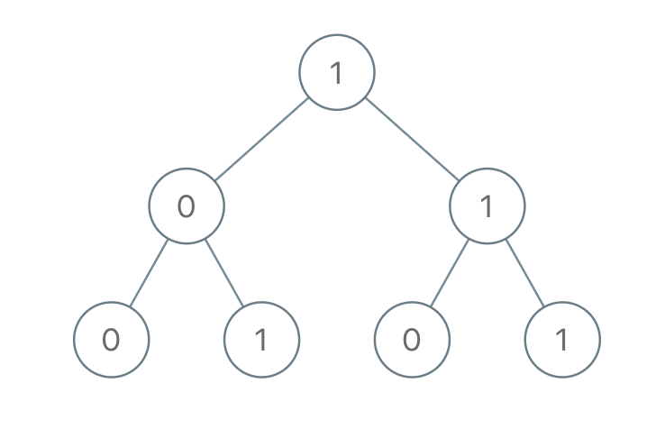

# [1022. Sum of Root To Leaf Binary Numbers](https://leetcode.com/problems/sum-of-root-to-leaf-binary-numbers/)

| Category | Difficulty | Likes | Dislikes |
| :------: | :--------: | :---: | :------: |
| Algorithms | Easy | 3439 | 196 |

**Tags:** [`tree`](https://leetcode.com/tag/tree), [`depth-first-search`](https://leetcode.com/tag/depth-first-search), [`binary-tree`](https://leetcode.com/tag/binary-tree)

**Companies:** `amazon`

## Description

You are given the `root` of a binary tree where each node has a value `0` or `1`. Each root-to-leaf path represents a binary number starting with the most significant bit.

	- For example, if the path is `0 -> 1 -> 1 -> 0 -> 1`, then this could represent `01101` in binary, which is `13`.

For all leaves in the tree, consider the numbers represented by the path from the root to that leaf. Return *the sum of these numbers*.

The test cases are generated so that the answer fits in a **32-bits** integer.

 

**Example 1:**


```

Input: root = [1,0,1,0,1,0,1]
Output: 22
Explanation: (100) + (101) + (110) + (111) = 4 + 5 + 6 + 7 = 22

```

**Example 2:**

```

Input: root = [0]
Output: 0

```

 

**Constraints:**

	- The number of nodes in the tree is in the range `[1, 1000]`.

	- `Node.val` is `0` or `1`.

---

**Links:** [Submissions](https://leetcode.com/problems/sum-of-root-to-leaf-binary-numbers/) | [Solutions](https://leetcode.com/problems/sum-of-root-to-leaf-binary-numbers/)
