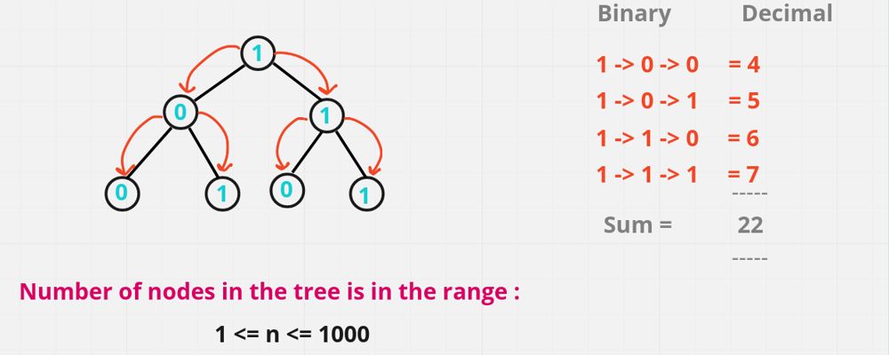
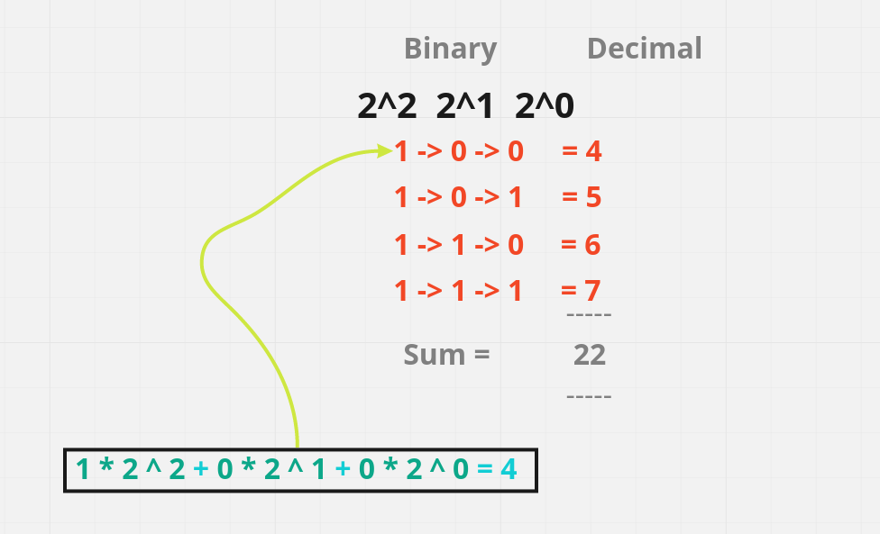

# 💥 Well Detailed Explaination [Java , C++, Python] || Easy for mind to Accept it

**Author:** hi-malik
**Votes:** 178
**Link:** [https://leetcode.com/problems/sum-of-root-to-leaf-binary-numbers/solutions/1681682/](https://leetcode.com/problems/sum-of-root-to-leaf-binary-numbers/solutions/1681682/)

---

Guy's if you find this solution helpful \uD83D\uDE0A, PLEASE do UPVOTE. By doing that it motivate's me to create more better post like this \u270D\uFE0F


**So Ladies n Gentlemen without any further due let's start,**
So, here in this problem what we have to do all the nodes will have either **0** or **1**. So, starting from **root node** and traverse the tree, when you traverse the tree and you reach **leaf node** return the **sum** in binary from root to leaf in & return in **decimal numbers**

**Approach Explained :**

**Summary :**
Let us traverse our tree and change values of nodes, so when we reach leaf we will have in this leaf exactly the number we need to add to total sum. Imagine, we have path 10110, then let us look at sequence: 1, 10, 101, 1011, 10110, which is equivalent to 1, 2, 5, 11, 22.

* If we reached leaf, add value of this leaf to total sum.
* Check left and right children and if they exist, update their values; run dfs for these children.

**Detailed Explanation :**
Let's understand with an example tree,




If we go from **1 to 0** i.e **left child** & similar for **1 to 1** i.e. **right child** and similar till leaf node. Overall there are 4 leafs path. So, we will have **4 root to leaf path**. So, one is **1 -> 0 -> 0** this left most path, second is **1 -> 0 -> 1** this is 2nd path, then **1 -> 1 -> 0** this is 3rd path & the last **1 -> 1 -> 1** 4th path. 
So, these all are the root to leaf path we have and these are **binary representation**. So, if we **convert** them to **decimal** they will become **4, 5, 6, 7**. And **sum** them up which is **22**. and we have to **return 22** as the answer.

So,  first of all when we are converting **binary** no **to** the **decimal**, what we will do we will start from the least significant bit & multiply it with **2^0** with **whatever** **no**. present there, then **2^1 with whatever no**. there & then **2^2** **with whatever no** and **add** them. So, this is how it become **1 * 4 + 2 * 0 + 1 * 0** which is equals to **4** and similar for other as well. So, this is the basic idea what we  have & we use this idea over here.
`Let me show you in a diagram, what i mean`



One of the **brute force idea to solve this** is like, 1st generate all the binary representation root to leaf path. Either store it as a list of list of integer or list of string & then convert after finding all the root to leaf path & convert each path to the decimal and then accumulate the sum and return. So, this is like a brute force solution.

But, we will make use of **recursion** to solve this problem.
And for traversing on each nodes we will use help of **PreOrder traversal**. Which states **"n l r"** i.e. **node - left - right**

I hope all point's are clear,
**Now let's code it:**

*code each n every line explain :* `Similar for C++. Java. Python` **{Only Syntax Difference}** approach same

Step 1 :
```
{// call to a preorder traversal function & passing the value root node & sum variable intialize with 0;
        return sumRootToLeaf(root, 0); 
```
Step 2 :
```
int sumRootToLeaf(TreeNode root, int sum){ // calling the helper method
        // base condition
        if(root == null) return 0; // first we will check if root is null, then there is no node, simply return 0;
        sum = (2 * sum) + root.val; // calculate sum of binary no.s into decimal no.s
        // checking if, current node we are processing is leaf & both left & right child node are null, if that's the case return sum;
        if(root.left == null && root.right == null) return sum;
        // and finally we will call both left subtree & right subtree and add them up
        return sumRootToLeaf(root.left, sum) + sumRootToLeaf(root.right, sum);
```


**Java**
```
class Solution {
    public int sumRootToLeaf(TreeNode root) {
        return sumRootToLeaf(root, 0);
    }
    public int sumRootToLeaf(TreeNode root, int sum){
        if(root == null) return 0;
        sum = (2 * sum) + root.val;
        if(root.left == null && root.right == null) return sum;
        return sumRootToLeaf(root.left, sum) + sumRootToLeaf(root.right, sum);
    }
}
```
**C++**
```
class Solution {
    int sumRootToLeaf(TreeNode* root, int sum){
        if(!root) return 0;
        sum = (2 * sum) + root->val;
        if(!root->left && !root->right) return sum;
        return sumRootToLeaf(root->left, sum) + sumRootToLeaf(root->right, sum);
    }
public:
    int sumRootToLeaf(TreeNode* root) {
        return sumRootToLeaf(root, 0);
    }
    
};
```
**Python**
```
class Solution:
    def sumRootToLeaf(self, root: Optional[TreeNode]) -> int:
        def sumRootToLeaf(root, res): # here; "res" is "sum"
            if root == None: return 0
            res = (2 * res) + root.val
            if root.left == None and root.right == None: return res
            return sumRootToLeaf(root.left, res) + sumRootToLeaf(root.right, res)
        
        return sumRootToLeaf(root, 0)
```
ANALYSIS :-
* **Time Complexity :-** BigO(N) where N is a number of nodes, since one has to visit each node.

* **Space Complexity :-** BigO(H) where H is height of tree, Considering recursion stack it in O(H), if we dont consider it. Then O(1)

If you have some \uD83E\uDD14 doubts feel free to bug me anytime or If you understood than don't forget to upvote \uD83D\uDC4D