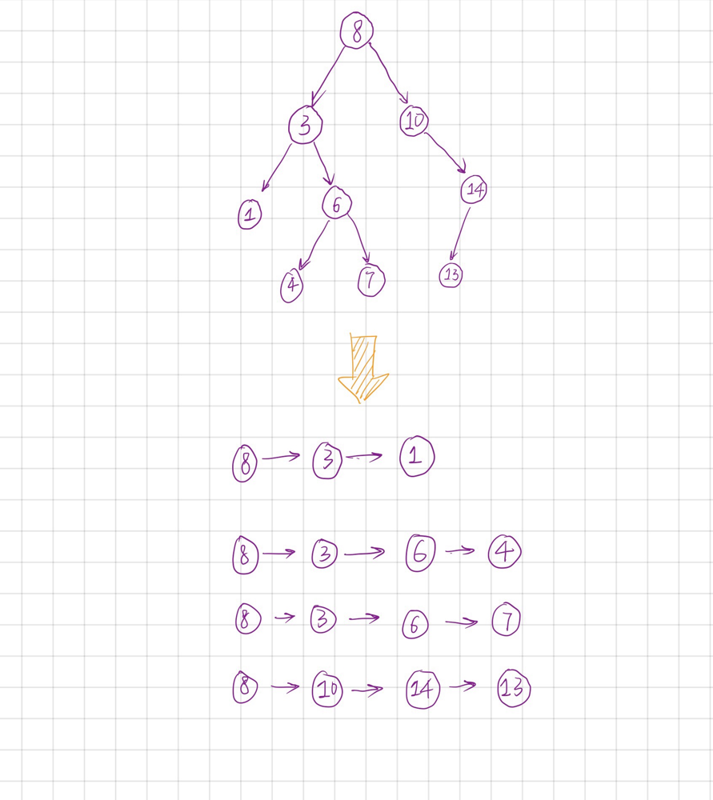

# non-recursive C++ solution(beat 99.72%), concisely explained

**Author:** EtoDemerzel
**Votes:** 39
**Link:** [https://leetcode.com/problems/maximum-difference-between-node-and-ancestor/solutions/284685/](https://leetcode.com/problems/maximum-difference-between-node-and-ancestor/solutions/284685/)

---

**The key idea: You are not working on a whole tree, you are working on several sequences.**

# Why sequences?

In this problem, we only care about the relationship between a node and its parent or children, so we don't have to see the tree as a 2-D data structure, instead, we can see it as a collection of several sequences,  which is a 1-D structure so that we could easily handle.

See the following figure as an example



For this tree, we have four sequences:
        
		[8, 3, 2],  [8, 3, 6, 4],  [8, 3, 6, 4],  [8, 10, 14, 13] 

For each sequence, a left element is an ancestor of its successors. So `the max element - the min element` in each sequence is a local max difference between node and ancestor, and the global maximum should be `max(max element - min element\uFF0C for each sequence) `. Such comparison could be done quite easily.

# How to find these sequences?

We use DFS to find these sequences. For an node in a sequence, we maintain the current (till we reach this node) max and min value of the sequence. When we reach a leave, the current max and min should be those of the whole sequence.

The C++ implementation(8ms, 11MB) is as following, it beats 99.72% of all submissions.


```c++
typedef tuple<TreeNode*, int, int> tup;

class Solution {
public:
    int maxAncestorDiff(TreeNode* root) {
        if (root == nullptr) return 0;

        stack <tup> s;
        int max_val = root->val, min_val = root->val, max_diff = 0;
        s.push(make_tuple(root, root->val, root->val));
        while(!s.empty()){
            tup cur_tup = s.top();
            s.pop();

            auto node = get<0>(cur_tup);
            int cur_max = get<1>(cur_tup), cur_min = get<2>(cur_tup);
            if(node->right){
                s.push(make_tuple(node->right, max(node->right->val, cur_max), min(node->right->val, cur_min)));
            }

            if(node->left){
                s.push(make_tuple(node->left, max(node->left->val, cur_max), min(node->left->val, cur_min)));
            }

            if(node->left==nullptr && node->right== nullptr){
                if (cur_max - cur_min > max_diff) max_diff = cur_max - cur_min;
            }

        }   

        return max_diff;
    }
    
};
```