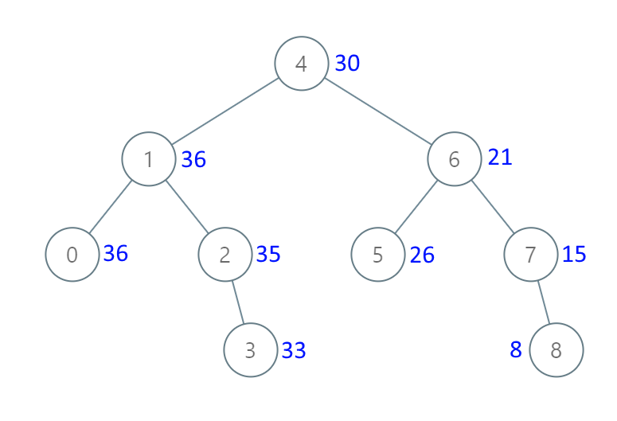

# [1038. Binary Search Tree to Greater Sum Tree](https://leetcode.com/problems/binary-search-tree-to-greater-sum-tree/)

| Category | Difficulty | Likes | Dislikes |
| :------: | :--------: | :---: | :------: |
| Algorithms | Medium | 4519 | 169 |

**Tags:** [`tree`](https://leetcode.com/tag/tree), [`depth-first-search`](https://leetcode.com/tag/depth-first-search), [`binary-search-tree`](https://leetcode.com/tag/binary-search-tree), [`binary-tree`](https://leetcode.com/tag/binary-tree)

**Companies:** `amazon`, `sap`

## Description

Given the `root` of a Binary Search Tree (BST), convert it to a Greater Tree such that every key of the original BST is changed to the original key plus the sum of all keys greater than the original key in BST.

As a reminder, a *binary search tree* is a tree that satisfies these constraints:

	- The left subtree of a node contains only nodes with keys **less than** the node's key.

	- The right subtree of a node contains only nodes with keys **greater than** the node's key.

	- Both the left and right subtrees must also be binary search trees.

 

**Example 1:**


```

Input: root = [4,1,6,0,2,5,7,null,null,null,3,null,null,null,8]
Output: [30,36,21,36,35,26,15,null,null,null,33,null,null,null,8]

```

**Example 2:**

```

Input: root = [0,null,1]
Output: [1,null,1]

```

 

**Constraints:**

	- The number of nodes in the tree is in the range `[1, 100]`.

	- `0 https://leetcode.com/problems/convert-bst-to-greater-tree/

---

**Links:** [Submissions](https://leetcode.com/problems/binary-search-tree-to-greater-sum-tree/) | [Solutions](https://leetcode.com/problems/binary-search-tree-to-greater-sum-tree/)
