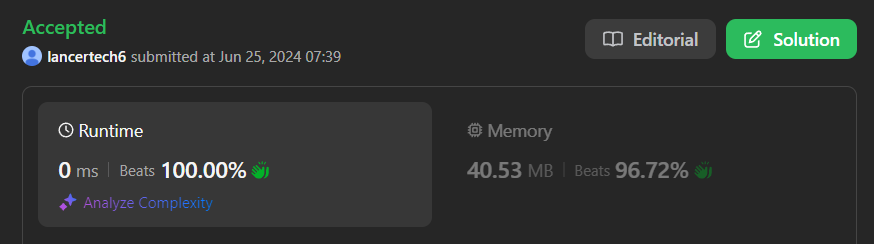

# ✅Beats 100% -Explained with [ Video ] -C++/Java/Python/JS -Reverse Inorder Traversal - Easy

**Author:** lancertech6
**Votes:** 136
**Link:** [https://leetcode.com/problems/binary-search-tree-to-greater-sum-tree/solutions/5364556/](https://leetcode.com/problems/binary-search-tree-to-greater-sum-tree/solutions/5364556/)

---



# YouTube Video Explanation:

### To watch the video please click on "Watch On Youtube" option  available the left bottom corner of the thumbnail.

<!-- **If you want a video for this question please write in the comments** -->


https://youtu.be/rCfTaQDopBY


**\uD83D\uDD25 Please like, share, and subscribe to support our channel's mission of making complex concepts easy to understand.**

Subscribe Link: https://www.youtube.com/@leetlogics/?sub_confirmation=1

*Subscribe Goal: 2300 Subscribers*
*Current Subscribers: 2297*

Follow me on Instagram : https://www.instagram.com/divyansh.nishad/

---


# Intuition
<!-- Describe your first thoughts on how to solve this problem. -->
To convert a Binary Search Tree (BST) to a Greater Tree, we need to ensure that every node's value is updated to the sum of all values greater than or equal to the node's value. In a BST, an in-order traversal gives us the nodes in increasing order. To achieve the desired transformation, we need to traverse the tree in reverse in-order (right-root-left), accumulating the sum of the node values as we go.

# Approach
<!-- Describe your approach to solving the problem. -->
1. **Reverse In-Order Traversal:** 
   - We traverse the BST starting from the rightmost node (which has the largest value) to the leftmost node (which has the smallest value). 
   - While traversing, we keep a running total (`sum`) of all the node values we have seen so far.
   - As we visit each node, we update its value by adding the current `sum` to the node's value and then update `sum` to this new value.

2. **Recursive Function:**
   - We use a helper function to perform the reverse in-order traversal.
   - This function will be called recursively first on the right subtree, then the current node, and finally on the left subtree.


# Step by Step Explanation

**Example:**

Input BST:
```
        4
       / \\
      1   6
     / \\ / \\
    0  2 5  7
         \\   \\
          3   8
```

Steps:
1. Traverse to the rightmost node:
   - Current Node: `8`, `Sum: 0`, `New Node Value: 8`, `Updated Sum: 8`
2. Move to `7`:
   - Current Node: `7`, `Sum: 8`, `New Node Value: 15`, `Updated Sum: 15`
3. Continue to `6`:
   - Current Node: `6`, `Sum: 15`, `New Node Value: 21`, `Updated Sum: 21`
4. Continue to `5`:
   - Current Node: `5`, `Sum: 21`, `New Node Value: 26`, `Updated Sum: 26`
5. Move to `4`:
   - Current Node: `4`, `Sum: 26`, `New Node Value: 30`, `Updated Sum: 30`
6. Continue to `3`:
   - Current Node: `3`, `Sum: 30`, `New Node Value: 33`, `Updated Sum: 33`
7. Move to `2`:
   - Current Node: `2`, `Sum: 33`, `New Node Value: 35`, `Updated Sum: 35`
8. Continue to `1`:
   - Current Node: `1`, `Sum: 35`, `New Node Value: 36`, `Updated Sum: 36`
9. Finally, move to `0`:
   - Current Node: `0`, `Sum: 36`, `New Node Value: 36`, `Updated Sum: 36`

Output BST:
```
        30
       / \\
      36   21
     / \\ / \\
    36 35 26  15
         \\   \\
          33  8
```


# Complexity
- **Time Complexity:** `O(n)`, where `n` is the number of nodes in the BST. This is because we visit each node exactly once during the traversal.
- **Space Complexity:** `O(n)` in the worst case due to the recursion stack. However, this can be reduced to `O(h)` where `h` is the height of the tree, if the tree is balanced.


# Code
```java []
class Solution {
    private int sum = 0;
    
    public TreeNode bstToGst(TreeNode root) {  
        if (root != null) {
            bstToGst(root.right);  // Traverse the right subtree
            sum += root.val;  // Update the sum
            root.val = sum;  // Update the current node's value
            bstToGst(root.left);  // Traverse the left subtree
        }
        return root;
    }
}
```
```C++ []
class Solution {
private:
    int sum = 0;

    void traverse(TreeNode* root) {
        if (root) {
            traverse(root->right);  // Traverse the right subtree
            sum += root->val;  // Update the sum
            root->val = sum;  // Update the current node's value
            traverse(root->left);  // Traverse the left subtree
        }
    }

public:
    TreeNode* bstToGst(TreeNode* root) {
        traverse(root);
        return root;
    }
};
```
```Python []
class Solution(object):
    def __init__(self):
        self.sum = 0
    def bstToGst(self, root):
        if root:
            self.bstToGst(root.right)  # Traverse the right subtree
            self.sum += root.val  # Update the sum
            root.val = self.sum  # Update the current node's value
            self.bstToGst(root.left)  # Traverse the left subtree
        return root
        
```
```JavaScript []
var bstToGst = function(root) {
    let sum = 0;

    const traverse = (node) => {
        if (node) {
            traverse(node.right);  // Traverse the right subtree
            sum += node.val;  // Update the sum
            node.val = sum;  // Update the current node's value
            traverse(node.left);  // Traverse the left subtree
        }
    };

    traverse(root);
    return root;
};
```

