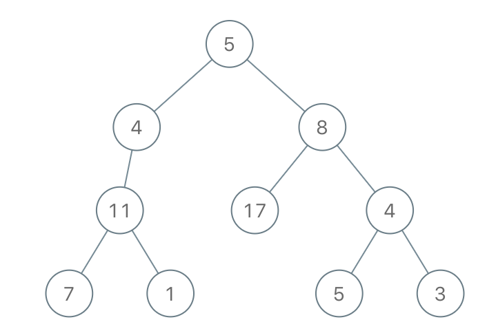

# [1080. Insufficient Nodes in Root to Leaf Paths](https://leetcode.com/problems/insufficient-nodes-in-root-to-leaf-paths/)

| Category | Difficulty | Likes | Dislikes |
| :------: | :--------: | :---: | :------: |
| Algorithms | Medium | 746 | 738 |

**Tags:** [`tree`](https://leetcode.com/tag/tree), [`depth-first-search`](https://leetcode.com/tag/depth-first-search), [`binary-tree`](https://leetcode.com/tag/binary-tree)

**Companies:** `amazon`

## Description

Given the `root` of a binary tree and an integer `limit`, delete all **insufficient nodes** in the tree simultaneously, and return *the root of the resulting binary tree*.

A node is **insufficient** if every root to **leaf** path intersecting this node has a sum strictly less than `limit`.

A **leaf** is a node with no children.

 

**Example 1:**


```

Input: root = [1,2,3,4,-99,-99,7,8,9,-99,-99,12,13,-99,14], limit = 1
Output: [1,2,3,4,null,null,7,8,9,null,14]

```

**Example 2:**


```

Input: root = [5,4,8,11,null,17,4,7,1,null,null,5,3], limit = 22
Output: [5,4,8,11,null,17,4,7,null,null,null,5]

```

**Example 3:**


```

Input: root = [1,2,-3,-5,null,4,null], limit = -1
Output: [1,null,-3,4]

```

 

**Constraints:**

	- The number of nodes in the tree is in the range `[1, 5000]`.

	- `-10^5 <= Node.val <= 10^5`

	- `-10^9 <= limit <= 10^9`

---

**Links:** [Submissions](https://leetcode.com/problems/insufficient-nodes-in-root-to-leaf-paths/) | [Solutions](https://leetcode.com/problems/insufficient-nodes-in-root-to-leaf-paths/)
