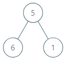

# [1120. Maximum Average Subtree](https://leetcode.com/problems/maximum-average-subtree/)

| Category | Difficulty | Likes | Dislikes |
| :------: | :--------: | :---: | :------: |
| Algorithms | Medium | 857 | 36 |

**Tags:** [`tree`](https://leetcode.com/tag/tree), [`depth-first-search`](https://leetcode.com/tag/depth-first-search), [`binary-tree`](https://leetcode.com/tag/binary-tree)

**Companies:** `amazon`

## Description

Given the `root` of a binary tree, return *the maximum **average** value of a **subtree** of that tree*. Answers within `10^-5` of the actual answer will be accepted.

A **subtree** of a tree is any node of that tree plus all its descendants.

The **average** value of a tree is the sum of its values, divided by the number of nodes.

 

**Example 1:**


```

Input: root = [5,6,1]
Output: 6.00000
Explanation: 
For the node with value = 5 we have an average of (5 + 6 + 1) / 3 = 4.
For the node with value = 6 we have an average of 6 / 1 = 6.
For the node with value = 1 we have an average of 1 / 1 = 1.
So the answer is 6 which is the maximum.

```

**Example 2:**

```

Input: root = [0,null,1]
Output: 1.00000

```

 

**Constraints:**

	- The number of nodes in the tree is in the range `[1, 10^4]`.

	- `0 <= Node.val <= 10^5`

---

**Links:** [Submissions](https://leetcode.com/problems/maximum-average-subtree/) | [Solutions](https://leetcode.com/problems/maximum-average-subtree/)
