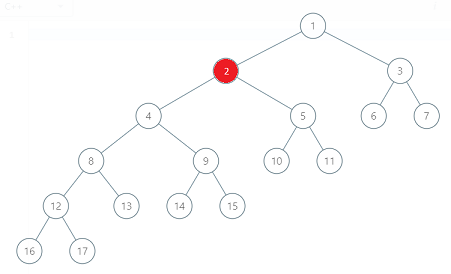
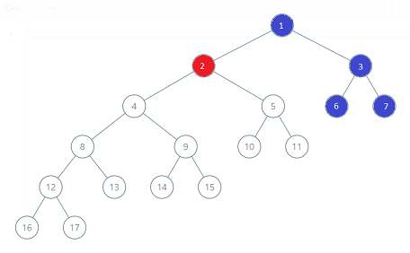
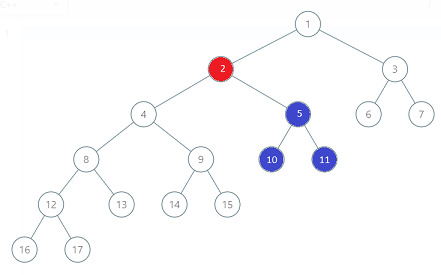
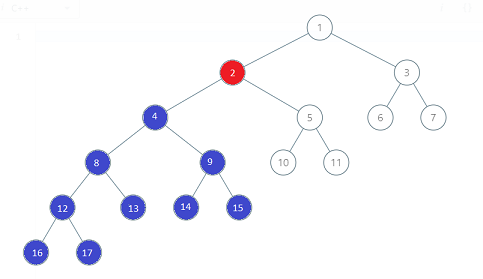

# c++,0ms, modular, beats 100% (both time and memory) with algo and image

**Author:** goelrishabh5
**Votes:** 65
**Link:** [https://leetcode.com/problems/binary-tree-coloring-game/solutions/350692/](https://leetcode.com/problems/binary-tree-coloring-game/solutions/350692/)

---

The second player will pick y as either left child, right child or parent (depending on which one has max nodes in their vicinity) of the node picked by first player.
If the no of nodes available for second player is greater than first, he wins 
Note : Equal case will never arise since n is odd

For example : 
  **parent(b:4)**  **right child (b:3)**  **left child (b:9)**    

Here, blue wins since it will pick left child. Thus, 9 will be left for blue and for red , 8 will be left

```
TreeNode* findNode(TreeNode* root,int x)
    {
        TreeNode* temp = NULL;
        if(root)
        {
            if(root->val==x)
                temp = root;
            else
            {
            temp = findNode(root->left,x);
            if(!temp)
            temp = findNode(root->right,x);
            }
        }
        return temp;
    }
    
    void countChildren(TreeNode* root, int &no)
    {
        if(root)
        {
            no++;
            countChildren(root->left,no);
            countChildren(root->right,no);    
        }
    }
    
    bool btreeGameWinningMove(TreeNode* root, int n, int x) {
        
        int left=0,right=0,parent=0,blue=0;
        TreeNode* temp = findNode(root,x); // find node
        countChildren(temp->left,left);  // count no of nodes in left subtree
        countChildren(temp->right,right); // count no of nodes in right subtree
        blue=max(left,right);
        if(temp->val!=root->val)
            parent = n-(left+right+1); // count no of nodes apart from given node's subtree
        blue=max(blue,parent);
        
        return (blue)>(n-blue);
    }
```