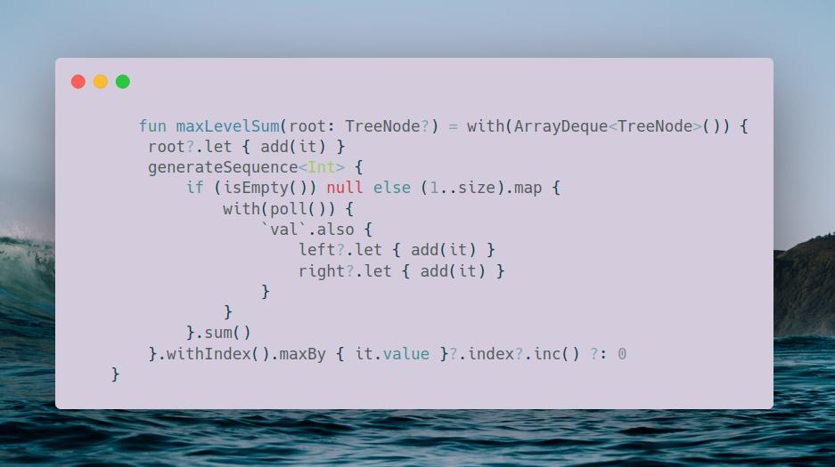

# Kotlin | BFS

**Author:** SamoylenkoDmitry
**Votes:** 1
**Link:** [https://leetcode.com/problems/maximum-level-sum-of-a-binary-tree/solutions/3639491/](https://leetcode.com/problems/maximum-level-sum-of-a-binary-tree/solutions/3639491/)

---



#### Join me on Telegram Leetcode_daily
https://t.me/leetcode_daily_unstoppable/246
#### Problem TLDR
Binary Tree level with max sum

#### Intuition
We can use Breadth-First Search to find a `sum` of each level.

#### Approach
Let's try to write it in a Kotlin style
#### Complexity
- Time complexity:
$$O(n)$$
- Space complexity:
$$O(n)$$
#### Code
```

    fun maxLevelSum(root: TreeNode?) = with(ArrayDeque<TreeNode>()) {
        root?.let { add(it) }
        generateSequence<Int> {
            if (isEmpty()) null else (1..size).map {
                with(poll()) {
                    `val`.also {
                        left?.let { add(it) }
                        right?.let { add(it) }
                    }
                }
            }.sum()
        }.withIndex().maxBy { it.value }?.index?.inc() ?: 0
    }

```