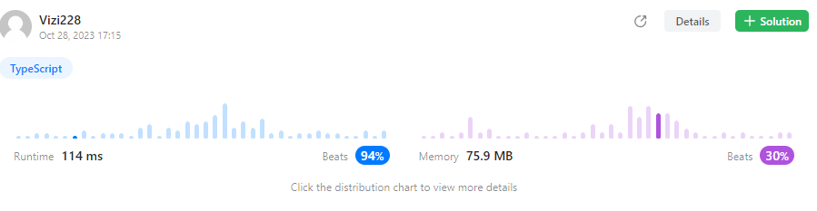

# ✅BFS🔥 | QUEUE🔥 | TYPESCRIPT🔥 | 94%🔥!!!✅

**Author:** Vizi228
**Votes:** 4
**Link:** [https://leetcode.com/problems/maximum-level-sum-of-a-binary-tree/solutions/4218518/](https://leetcode.com/problems/maximum-level-sum-of-a-binary-tree/solutions/4218518/)

---



# Approach
<!-- Describe your approach to solving the problem. -->
In this solution we have:
    -Time complexity O(n) where n is count of all nodes
    -Space complexity O(w) where w is count of all nodes in one level(width of level)
    The main point of this approach that we moving down our tree and for each level count sum of nodes value. Also we use dynamic queue for changing level. It mean that next level appears when we finished iteration for every nodes of current level and after that we change the level and check sum of our level, if it more than our current max sum, we change max to current sum  

# Complexity
- Time complexity: $$O(n)$$
<!-- Add your time complexity here, e.g. $$O(n)$$ -->

- Space complexity: $$O(w)$$
<!-- Add your space complexity here, e.g. $$O(n)$$ -->

# Code
```
function maxLevelSum(root: TreeNode | null): number {
    let max = -Infinity;
    let maxLevel = 0;
    let level = 0;
    let queue = [root];

    while(queue.length) {
        let sum = 0;
        const tmp = [];
        for(let i = 0; i < queue.length; i++) {
            const node = queue[i];
            if (node.left) tmp.push(node.left);
            if (node.right) tmp.push(node.right);
            sum += node.val;
        }
        queue = tmp;
        level++
        if (sum > max) {
            max = sum;
            maxLevel = level;
        }
    }

    return maxLevel;
};
```