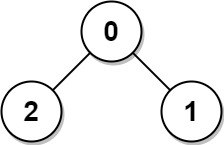
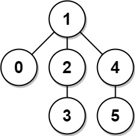

# [1245. Tree Diameter](https://leetcode.com/problems/tree-diameter/)

| Category | Difficulty | Likes | Dislikes |
| :------: | :--------: | :---: | :------: |
| Algorithms | Medium | 897 | 25 |

**Tags:** [`tree`](https://leetcode.com/tag/tree), [`depth-first-search`](https://leetcode.com/tag/depth-first-search), [`breadth-first-search`](https://leetcode.com/tag/breadth-first-search), [`graph`](https://leetcode.com/tag/graph), [`topological-sort`](https://leetcode.com/tag/topological-sort)

**Companies:** `facebook`, `amazon`, `goldman-sachs`, `tiktok`, `microsoft`, `apple`, `google`

## Description

The **diameter** of a tree is **the number of edges** in the longest path in that tree.

There is an undirected tree of `n` nodes labeled from `0` to `n - 1`. You are given a 2D array `edges` where `edges.length == n - 1` and `edges[i] = [a_i, b_i]` indicates that there is an undirected edge between nodes `a_i` and `b_i` in the tree.

Return *the **diameter** of the tree*.

 

**Example 1:**


```

Input: edges = [[0,1],[0,2]]
Output: 2
Explanation: The longest path of the tree is the path 1 - 0 - 2.

```

**Example 2:**


```

Input: edges = [[0,1],[1,2],[2,3],[1,4],[4,5]]
Output: 4
Explanation: The longest path of the tree is the path 3 - 2 - 1 - 4 - 5.

```

 

**Constraints:**

	- `n == edges.length + 1`

	- `1 <= n <= 10^4`

	- `0 <= a_i, b_i < n`

	- `a_i != b_i`

---

**Links:** [Submissions](https://leetcode.com/problems/tree-diameter/) | [Solutions](https://leetcode.com/problems/tree-diameter/)
