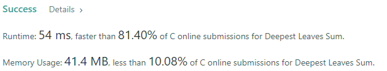
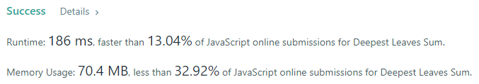
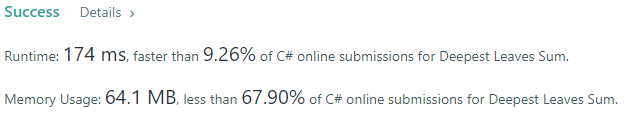
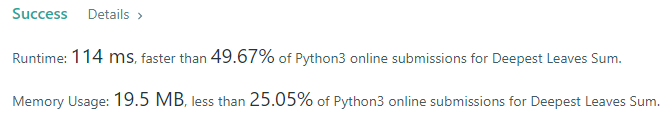
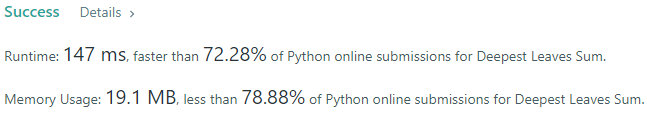
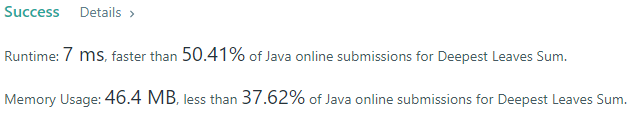
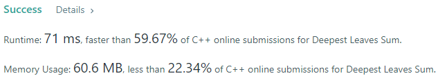

# 💢☠💫Easiest👾Faster✅💯 Lesser🧠 🎯 C++✅Python3🐍✅Java✅C✅Python🐍✅C#✅💥🔥💫Explained☠💥🔥 Beats 💯

**Author:** Edwards310
**Votes:** 4
**Link:** [https://leetcode.com/problems/deepest-leaves-sum/solutions/5665654/](https://leetcode.com/problems/deepest-leaves-sum/solutions/5665654/)

---

# Intuition









---

# ***Simple Intution is the Level Order Traversal, we simply taught that the deepest levels sum is the sum of the last level Tree Nodes.***
# ***So We Have to simply stores all levels sum in a vector and then return the last level sum from the vector. For reference you can visit my level order traversal explanation***
https://leetcode.com/problems/binary-tree-level-order-traversal/solutions/5029725/easiest-solution-python3-c-java-c-python-detailed-explanation-with-images
```javascript []
//JavaScript Code
/**
 * Definition for a binary tree node.
 * function TreeNode(val, left, right) {
 *     this.val = (val===undefined ? 0 : val)
 *     this.left = (left===undefined ? null : left)
 *     this.right = (right===undefined ? null : right)
 * }
 */
/**
 * @param {TreeNode} root
 * @return {number}
 */
var deepestLeavesSum = function(root) {
    let q = [root]
    let ans = 0
    while(q.length !== 0){
        ans = 0
        let n = q.length
        for(let i = 0; i < n; ++i){
            let node = q.shift()
            ans += node.val
            if(node.left)
                q.push(node.left)
            if(node.right)
                q.push(node.right)
        }
    }
    return ans
};
```
```python3 []
#python3 Code
# Definition for a binary tree node.
# class TreeNode:
#     def __init__(self, val=0, left=None, right=None):
#         self.val = val
#         self.left = left
#         self.right = right
class Solution:
    def deepestLeavesSum(self, root: Optional[TreeNode]) -> int:
        q = deque([root])
        ans = 0
        
        while q:
            n = len(q)
            ans = 0
            for _ in range(n):
                node = q.popleft()
                ans += node.val
                if node.left:
                    q.append(node.left)
                if node.right:
                    q.append(node.right)
        
        return ans
```
```C++ []
//C++ Code
// Start Of Edwards310's Template...
#pragma GCC optimize("O2")
#include <bits/stdc++.h>

using namespace std;

typedef vector<int> vi;

#define FOR(a, b, c) for (int a = b; a < c; a++)
#define FOR1(a, b, c) for (int a = b; a <= c; ++a)
#define Rep(i, n) FOR (i, 0, n)
#define Rep1(i, n) FOR1(i, 1, n)
#define pb push_back

#define qnode queue<TreeNode*>

// End of  Edwards310's Template
/**
* Definition for a binary tree node.
 * struct TreeNode {
 *     int val;
 *     TreeNode *left;
 *     TreeNode *right;
 *     TreeNode() : val(0), left(nullptr), right(nullptr) {}
 *     TreeNode(int x) : val(x), left(nullptr), right(nullptr) {}
 *     TreeNode(int x, TreeNode *left, TreeNode *right) : val(x), left(left),
 * right(right) {}
 * };
 */
class Solution {
public:
    int deepestLeavesSum(TreeNode* root) {
        vi sums;
        qnode q;
        q.push(root);
        while (!q.empty()) {
            int n = q.size();
            int sum = 0;
            Rep (i, n) {
                TreeNode* node = q.front();
                q.pop();
                sum += node->val;
                if (node->left)
                    q.push(node->left);
                if (node->right)
                    q.push(node->right);
            }
            sums.pb(sum);
        }
        return sums.back();
    }
};
```
```Java []
//Java Code
/**
 * Definition for a binary tree node.
 * public class TreeNode {
 *     int val;
 *     TreeNode left;
 *     TreeNode right;
 *     TreeNode() {}
 *     TreeNode(int val) { this.val = val; }
 *     TreeNode(int val, TreeNode left, TreeNode right) {
 *         this.val = val;
 *         this.left = left;
 *         this.right = right;
 *     }
 * }
 */
class Solution {
    public int deepestLeavesSum(TreeNode root) {
        int ans = 0;
        Queue<TreeNode> q = new LinkedList<>();
        q.add(root);
        while(!q.isEmpty()){
            ans = 0;
            int n = q.size();
            while(n-- > 0){
                TreeNode node = q.poll();
                ans += node.val;
                if(node.left != null)
                    q.add(node.left);
                if(node.right != null)
                    q.add(node.right);
            }
        }
        return ans;
    }
}
```
```C []
//C Code
/**
 * Definition for a binary tree node.
 * struct TreeNode {
 *     int val;
 *     struct TreeNode *left;
 *     struct TreeNode *right;
 * };
 */
typedef struct Queue {
    struct TreeNode** nodes; // Array of pointers to TreeNode
    int front;               // Index of the front element
    int rear;                // Index of the rear element
    int size;                // Current number of elements in the queue
    int capacity;            // Maximum number of elements the queue can hold
} Queue;

Queue* createQueue(int capacity) {
    Queue* queue = (Queue*)malloc(sizeof(Queue));
    queue->capacity = capacity;
    queue->size = 0;
    queue->front = 0;
    queue->rear = capacity - 1;
    queue->nodes = (struct TreeNode**)malloc(capacity * sizeof(struct TreeNode*));
    return queue;
}

bool isEmpty(Queue* queue) { 
    return queue->size == 0;
}

bool isQueueFull(Queue* queue) { 
    return queue->size == queue->capacity;
}

void push(Queue* queue, struct TreeNode* node) {
    if (isQueueFull(queue))
        return;
    queue->rear = (queue->rear + 1) % queue->capacity;
    queue->nodes[queue->rear] = node;
    queue->size++;
}

struct TreeNode* dequeue(Queue* queue) {
    if (isEmpty(queue))
        return NULL;

    struct TreeNode* node = queue->nodes[queue->front];
    queue->front = (queue->front + 1) % queue->capacity;
    queue->size--;
    return node;
}

void freeQueue(Queue* queue) {
    free(queue->nodes);
    free(queue);
}

int deepestLeavesSum(struct TreeNode* root) {
    int ans = 0;
    Queue* q = createQueue(100001);
    push(q, root);
    while (!isEmpty(q)) {
        int n = q->size;
        ans = 0;
        for (int i = 0; i < n; i++) {
            struct TreeNode* node = dequeue(q);
            ans += node->val;
            if (node->left)
                push(q, node->left);
            if (node->right)
                push(q, node->right);
        }
    }
    freeQueue(q);
    return ans;
}
```
```Python []
#Python Code
# Definition for a binary tree node.
# class TreeNode(object):
#     def __init__(self, val=0, left=None, right=None):
#         self.val = val
#         self.left = left
#         self.right = right
class Solution(object):
    def deepestLeavesSum(self, root):
        """
        :type root: TreeNode
        :rtype: int
        """
        q = collections.deque()
        q.append(root)
        ans = 0
        
        while q:
            n = len(q)
            ans = 0
            for _ in range(n):
                node = q.popleft()
                ans += node.val
                if node.left:
                    q.append(node.left)
                if node.right:
                    q.append(node.right)
        
        return ans
                
            
```
```C# []
//C# Code
/**
 * Definition for a binary tree node.
 * public class TreeNode {
 *     public int val;
 *     public TreeNode left;
 *     public TreeNode right;
 *     public TreeNode(int val=0, TreeNode left=null, TreeNode right=null) {
 *         this.val = val;
 *         this.left = left;
 *         this.right = right;
 *     }
 * }
 */
public class Solution {
    public int DeepestLeavesSum(TreeNode root) {
        int ans = 0;
        Queue<TreeNode> q = new Queue<TreeNode>();
        q.Enqueue(root);
        while(q.Count() != 0){
            ans = 0;
            int n = q.Count();
            for(int i = 0; i < n; ++i){
                TreeNode node = q.Dequeue();
                ans += node.val;
                if(node.left != null)
                    q.Enqueue(node.left);
                if(node.right != null)
                    q.Enqueue(node.right);
            }
        }
        return ans;
    }
}
```

<!-- Describe your first thoughts on how to solve this problem. -->

# Approach
<!-- Describe your approach to solving the problem. -->

# Complexity
- Time complexity:
<!-- Add your time complexity here, e.g. $$O(n)$$ -->
     O(N^2)
- Space complexity:
<!-- Add your space complexity here, e.g. $$O(n)$$ -->
     O(1)
# Code
```c []
/**
 * Definition for a binary tree node.
 * struct TreeNode {
 *     int val;
 *     struct TreeNode *left;
 *     struct TreeNode *right;
 * };
 */
typedef struct Queue {
    struct TreeNode** nodes; // Array of pointers to TreeNode
    int front;               // Index of the front element
    int rear;                // Index of the rear element
    int size;                // Current number of elements in the queue
    int capacity;            // Maximum number of elements the queue can hold
} Queue;

Queue* createQueue(int capacity) {
    Queue* queue = (Queue*)malloc(sizeof(Queue));
    queue->capacity = capacity;
    queue->size = 0;
    queue->front = 0;
    queue->rear = capacity - 1;
    queue->nodes = (struct TreeNode**)malloc(capacity * sizeof(struct TreeNode*));
    return queue;
}

bool isEmpty(Queue* queue) { 
    return queue->size == 0;
}

bool isQueueFull(Queue* queue) { 
    return queue->size == queue->capacity;
}

void push(Queue* queue, struct TreeNode* node) {
    if (isQueueFull(queue))
        return;
    queue->rear = (queue->rear + 1) % queue->capacity;
    queue->nodes[queue->rear] = node;
    queue->size++;
}

struct TreeNode* dequeue(Queue* queue) {
    if (isEmpty(queue))
        return NULL;

    struct TreeNode* node = queue->nodes[queue->front];
    queue->front = (queue->front + 1) % queue->capacity;
    queue->size--;
    return node;
}

void freeQueue(Queue* queue) {
    free(queue->nodes);
    free(queue);
}

int deepestLeavesSum(struct TreeNode* root) {
    int ans = 0;
    Queue* q = createQueue(100001);
    push(q, root);
    while (!isEmpty(q)) {
        int n = q->size;
        ans = 0;
        for (int i = 0; i < n; i++) {
            struct TreeNode* node = dequeue(q);
            ans += node->val;
            if (node->left)
                push(q, node->left);
            if (node->right)
                push(q, node->right);
        }
    }
    freeQueue(q);
    return ans;
}
```


