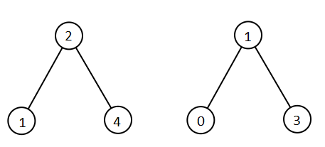
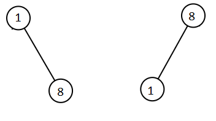

# [1305. All Elements in Two Binary Search Trees](https://leetcode.com/problems/all-elements-in-two-binary-search-trees/)

| Category | Difficulty | Likes | Dislikes |
| :------: | :--------: | :---: | :------: |
| Algorithms | Medium | 3172 | 98 |

**Tags:** [`tree`](https://leetcode.com/tag/tree), [`depth-first-search`](https://leetcode.com/tag/depth-first-search), [`binary-search-tree`](https://leetcode.com/tag/binary-search-tree), [`sorting`](https://leetcode.com/tag/sorting), [`binary-tree`](https://leetcode.com/tag/binary-tree)

**Companies:** `facebook`, `amazon`

## Description

Given two binary search trees `root1` and `root2`, return *a list containing all the integers from both trees sorted in **ascending** order*.

 

**Example 1:**


```

Input: root1 = [2,1,4], root2 = [1,0,3]
Output: [0,1,1,2,3,4]

```

**Example 2:**


```

Input: root1 = [1,null,8], root2 = [8,1]
Output: [1,1,8,8]

```

 

**Constraints:**

	- The number of nodes in each tree is in the range `[0, 5000]`.

	- `-10^5 <= Node.val <= 10^5`

---

**Links:** [Submissions](https://leetcode.com/problems/all-elements-in-two-binary-search-trees/) | [Solutions](https://leetcode.com/problems/all-elements-in-two-binary-search-trees/)
