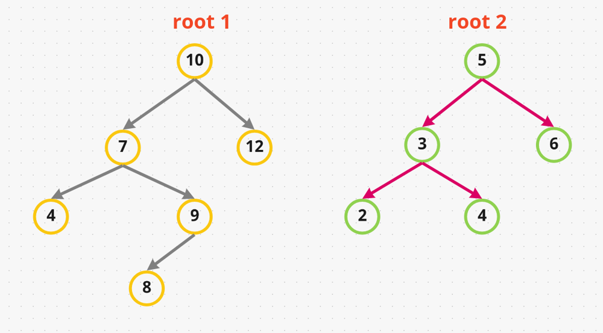
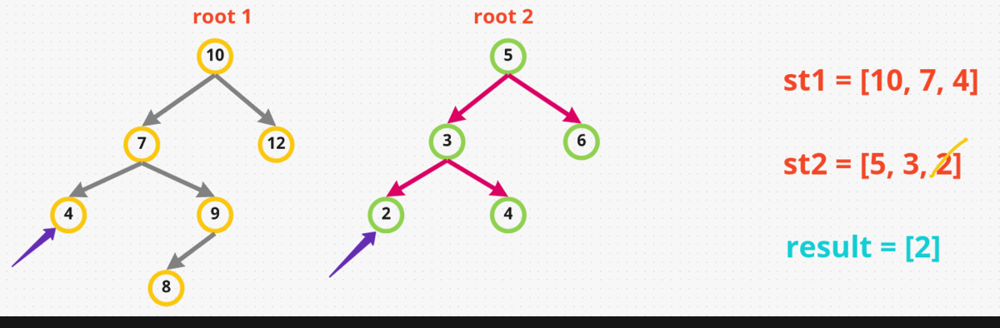

# [Java/C++/Python] A very-very detailed EXPLANATION

**Author:** hi-malik
**Votes:** 272
**Link:** [https://leetcode.com/problems/all-elements-in-two-binary-search-trees/solutions/1720210/](https://leetcode.com/problems/all-elements-in-two-binary-search-trees/solutions/1720210/)

---

```
So, what the question is saying, we have " Given two binary search trees root1 and root2, 
return a list containing all the integers from both trees sorted in ascending order "
```

Let's try to this problem Understand with an example :-


```
So, there are couples of way to solve this problem:
```
* The 1st way is get the values in an array and **sort that array.**
So, as per given example how we get the value in array is by traversing. So, we will use **InOrder traversal** to traverse the tree and get the values, so after traversing both **root1 tree & root2 tree**. In our array we will have : **[4,7,9,8, 10, 12, 2,3,4,5,6]**
But the problem in this is it's Time Complexity which we will get some where around - **BigO( M + N + (M + N)log(M + N))** = **BigO((M + N)log(M + N))**

* The 2nd way to solve this problem is we will traverse **InOrderly** and store the value of **root1 tree in different array** & **root2 tree value in another array**. So, by doing that in our 2 arrays we will have something like : **arr1 = [4,7,9,8,10,12] & arr2 = [2,3,4,5,6]**. Now what we have to do is, compare there values and **merge them in another array**. We will get our `answer`
In this Algorithm Time Complexity will be **BigO((M + N) + (M + N)) = BigO(M + N)**
So, you can do it in that way as well.

`But to solve the problem we will use more optimize way instead of using Arrays, we will use Stack`

So, First we will create `2 stacks`, one is for **root1** & another is for **root2**. We will traverse **Inorderly** and fill the stack
* If  we traverse first on **root1 tree on it's left**. So in our stack1 we will have **[10, 7, 4]** and after that the current pointer has reach null
* Similarly, we will traverse on **root2 tree on it's left**. So in our stack2 we will have **[5, 3, 2]** and after that the current pointer has reach null
* Now, we will stop and compare there top values which one is smaller so, **2 is smaller then 4**, we will put **2 in our answer list i.e. [2]** and **pop it from stack2**
* Again we compare **3 with 4 as 3 is smaller**, put **3 in our answer list i.e. [2,3]** and **pop it from stack2**
* Now we put **4 from root2** into our stack2 i.e **[5,4]** and compare with **stack2 top value with stack1** they both are similar. So, let's say now we **pop 4 from stack1** and **put in our answer list i.e. [2,3,4]** 
* Now we will compare **7 from stack1 with 4 from stack2** as 4 is smaller, add it into our **answer list i.e. [2,3,4,4]** and **pop 4 from stack2**
* Next comparison will be b/w **7 & 5. 5 is smaller** add it into our **answer list i.e. [2,3,4,4,5]** and **pop 5 from stack2**
* Next we will insert **6 in our stack2** and compare **6 with 7**. So, **6 is smaller** add it into our **answer list i.e. [2,3,4,4,5,6]** and **pop 6 from stack2**
* So, `6 left is null and right is null as well. It's done`
* In our **stack1 we have [10, 7]** we will **pop 7 from stack1** & add it into our **answer list i.e. [2,3,4,4,5,7]**
* Now going to **7 right, put 9 in stack and 8 as well**. as we reach **leaf node we stop** and compare **stack1 top value with stack2**. As, **stack2 is already empty** no need to compare.
* Just simply **add 8** in our **answer list i.e. [2,3,4,4,5,7,8]** and **pop 8 from stack1**
* Moving to **9**, it's right is null simply add it into our **answer list i.e. [2,3,4,4,5,7,8,9]** and **pop 9 from stack1**
* Next is **10**, in our **stack just pop it** & add it into our **answer list i.e. [2,3,4,4,5,7,8,9,10]** Now we push it's right into stack1
* **I.e. 12** as 12 is **leaf node**. We will **stop and pop 12 add** it into our **answer list i.e. [2,3,4,4,5,7,8,9,10,12]**
* We are done and our `final result is :- [2,3,4,4,5,7,8,9,10,12]`




So, here in the given time a stack is holding at Max 3 elements which is proportional to depth of the tree 
**Time Complexity is BigO(M + N) and Space complexity is BigO(H1 + H2)**
This is just a slight optimisation and making algorithm a bit more elegant.

*I hope you got the point.* **Let's code it:**

*code each line explained :* `Similar for C++, Java, Python` **{Only Synatx Difference}** approach same
* Step - 1
```
{
        // Creating our 2 stacks
        Stack<TreeNode> st1 = new Stack<>();
        Stack<TreeNode> st2 = new Stack<>();
        // Created our result arraylist, where we will return our final answer
        List<Integer> res = new ArrayList<>();
```
* Step - 2
```
        // we will put all the elements in our stack until reach the leaf node
        // of both the root1 & root2 tree. First left, then right
        while(root1 != null || root2 != null || !st1.empty() || !st2.empty()){
            // filling our stack with all left values of root1 tree
            while(root1 != null){ // and root1 will act as current pointer  
                st1.push(root1);
                root1 = root1.left;
            }// filling our stack with all left values of root2 tree
            while(root2 != null){ // and root2 will act as current pointer 
                st2.push(root2);
                root2 = root2.left;
            }
            // either stack2 is empty we will pop all vaues from stack1 straight away but,
            // if stack2 is not empty then we will get their peek values
            // of both the stack1 & stack2 and compare them
            // if stack1 value is less then, add it into our result & move to right
            if(st2.empty() || (!st1.empty() && st1.peek().val <= st2.peek().val)){
                root1 = st1.pop();
                res.add(root1.val);
                root1 = root1.right;
            }
            // either stack1 is empty we will pop all vaues from stack2 straight away but,
            // if stack1 is not empty then we will get their peek values
            // of both the stack1 & stack2 and compare them
            // if stack2 value is less then, add it into our result & move to right
            else{
                root2 = st2.pop();
                res.add(root2.val);
                root2 = root2.right;
            }
        }
```
* Final Step
```
return res;
```

**Java**
```
class Solution {
    public List<Integer> getAllElements(TreeNode root1, TreeNode root2) {
        Stack<TreeNode> st1 = new Stack<>();
        Stack<TreeNode> st2 = new Stack<>();
        
        List<Integer> res = new ArrayList<>();
        
        while(root1 != null || root2 != null || !st1.empty() || !st2.empty()){
            while(root1 != null){
                st1.push(root1);
                root1 = root1.left;
            }
            while(root2 != null){
                st2.push(root2);
                root2 = root2.left;
            }
            if(st2.empty() || (!st1.empty() && st1.peek().val <= st2.peek().val)){
                root1 = st1.pop();
                res.add(root1.val);
                root1 = root1.right;
            }
            else{
                root2 = st2.pop();
                res.add(root2.val);
                root2 = root2.right;
            }
        }
        return res;
    }
}
```
**C++**
```
class Solution {
public:
    vector<int> getAllElements(TreeNode* root1, TreeNode* root2) {
        stack<TreeNode *> st1, st2;
        vector<int> res;
        
        while(root1 || root2 || !st1.empty() || !st2.empty()){
            while(root1){
                st1.push(root1);
                root1 = root1->left;
            }
            while(root2){
                st2.push(root2);
                root2 = root2->left;
            }
            if(st2.empty() || (!st1.empty() && st1.top()->val <= st2.top()->val)){
                root1 = st1.top();
                st1.pop();
                res.push_back(root1->val);
                root1 = root1->right;
            }
            else{
                root2 = st2.top();
                st2.pop();
                res.push_back(root2->val);
                root2 = root2->right;
            }
        }
        return res;
    }
};
```
**Python**
```
class Solution:
    def getAllElements(self, root1: TreeNode, root2: TreeNode) -> List[int]:
        st1, st2 = [], []
        res = []
        
        while root1 != None or root2 != None or len(st1) > 0 or len(st2) > 0:
            while root1 != None:
                st1.append(root1)
                root1 = root1.left
            while root2 != None:
                st2.append(root2)
                root2 = root2.left
            if len(st2) == 0 or (len(st1) > 0 and st1[-1].val <= st2[-1].val):
                root1 = st1.pop()
                res.append(root1.val)
                root1 = root1.right
            else:
                root2 = st2.pop()
                res.append(root2.val)
                root2 = root2.right
        return res
```