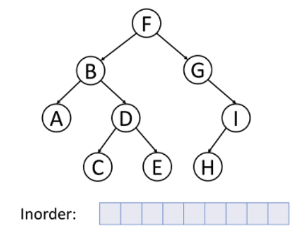

# 🚀 C++ || Best Explanation || Naive and Optimal

**Author:** intellisense
**Votes:** 95
**Link:** [https://leetcode.com/problems/all-elements-in-two-binary-search-trees/solutions/1719941/](https://leetcode.com/problems/all-elements-in-two-binary-search-trees/solutions/1719941/)

---

\uD83D\uDC68\u200D\uD83D\uDCBB Friend's if you find this solution helpful \uD83D\uDE0A, PLEASE do UPVOTE. By doing that motivates me to create a better post like this \u270D\uFE0F
____________________________________________________________________________________________________________
____________________________________________________________________________________________________________
### Take reference how inorder works for binary tree it will help in optimal approach.


#### \u2714\uFE0F **Question Conclusion**
* We have given two binary trees. we need to return a vector in increasing order after merging the trees.
#### \u2714\uFE0F **Solution - I (Naive Approach)**
##### **Intuition :-**
* Traverse both the tree and store its value in a vector.
* Sort the vector and return.
##### **Code :-**
```
class Solution
{
public:
     vector<int> res;
     void dfs(TreeNode *root)
     {
          if (!root)
               return;
          res.push_back(root->val);
          dfs(root->left);
          dfs(root->right);
     }
     vector<int> getAllElements(TreeNode *root1, TreeNode *root2)
     {
          dfs(root1);
          dfs(root2);
          sort(begin(res), end(res));
          return res;
     }
};
```
**Time Complexity** : `O(NlogN)`, as we are using sorting.
**Space Complexity** : `O(N)`, as we are only return total elements of both trees.
#### \u2714\uFE0F **Solution - II (Best Approach)**
##### **Intuition :-(let me know in comments your suggestion if having any trouble in understanding the intuition)**
* FYI Binary Tree inorder traversal give result in increasing order.
* Create stack for both tree and push element until `root->left is NULL`.
* Compare the top of both stack and push the smaller element in the result array.
* if any of the stack is empty we will push the top element of other stack and change `root = root->right `and same condition will be taken care for other stack.

##### **Code :-**
```
class Solution
{
public:
     vector<int> getAllElements(TreeNode *root1, TreeNode *root2)
     {
          vector<int> res;
          stack<TreeNode *> s1, s2;

          while (root1 || root2 || !s1.empty() || !s2.empty())
          {
               while (root1 != NULL)
               {
                    s1.push(root1);
                    root1 = root1->left;
               }
               while (root2 != NULL)
               {
                    s2.push(root2);
                    root2 = root2->left;
               }
               if (s2.empty() || (!s1.empty() && s1.top()->val <= s2.top()->val))
               {
                    root1 = s1.top();
                    s1.pop();
                    res.push_back(root1->val);
                    root1 = root1->right;
               }
               else
               {
                    root2 = s2.top();
                    s2.pop();
                    res.push_back(root2->val);
                    root2 = root2->right;
               }
          }
          return res;
     }
};
```
**Time Complexity** : `O(N)`,  maximum n elements are traversed
**Space Complexity** : `O(N)`, size of vector (tree1 + tree2)
_____________________________________________________________________________________________________________
_____________________________________________________________________________________________________________

\uD83D\uDCBBIf there are any suggestions/questions in my post, comment below \uD83D\uDC47