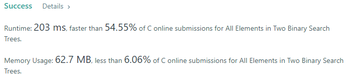
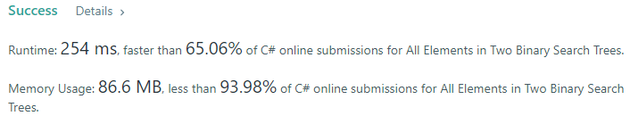
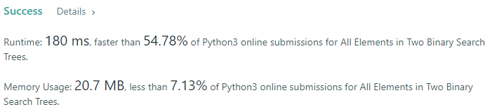
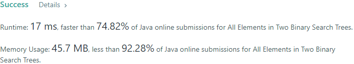

# 💢☠💫Easiest👾Faster✅💯 Lesser🧠 🎯 C++✅Python3🐍✅Java✅C✅Python🐍✅C#✅💥🔥💫Explained☠💥🔥 Beats 💯

**Author:** Edwards310
**Votes:** 2
**Link:** [https://leetcode.com/problems/all-elements-in-two-binary-search-trees/solutions/5668709/](https://leetcode.com/problems/all-elements-in-two-binary-search-trees/solutions/5668709/)

---

# Intuition








```javascript []
//JavaScript Code
/**
 * Definition for a binary tree node.
 * function TreeNode(val, left, right) {
 *     this.val = (val===undefined ? 0 : val)
 *     this.left = (left===undefined ? null : left)
 *     this.right = (right===undefined ? null : right)
 * }
 */
/**
 * @param {TreeNode} root1
 * @param {TreeNode} root2
 * @return {number[]}
 */
var getAllElements = function(root1, root2) {
    const arr = []
    dfs = ((root, arr) => {
        if(root == undefined)
            return
        dfs(root.left, arr)
        arr.push(root.val)
        dfs(root.right, arr)
    })
    dfs(root1, arr)
    dfs(root2, arr)
    arr.sort((a, b) => {
        return a - b
    })
    return arr
};
```
```C++ []
//C++ Code
// Start Of Edwards310's Template...
#pragma GCC optimize("O2")
#include <bits/stdc++.h>

using namespace std;

typedef vector<int> vi;

#define FOR(a, b, c) for (int a = b; a < c; a++)
#define FOR1(a, b, c) for (int a = b; a <= c; ++a)
#define Rep(i, n) FOR (i, 0, n)
#define Rep1(i, n) FOR1(i, 1, n)
#define pb push_back
#define ALL(v) v.begin(), v.end()
#define SORT(v) sort(ALL(v))
#define qnode queue<TreeNode*>

// End of  Edwards310's Template

/**
 * Definition for a binary tree node.
 * struct TreeNode {
 *     int val;
 *     TreeNode *left;
 *     TreeNode *right;
 *     TreeNode() : val(0), left(nullptr), right(nullptr) {}
 *     TreeNode(int x) : val(x), left(nullptr), right(nullptr) {}
 *     TreeNode(int x, TreeNode *left, TreeNode *right) : val(x), left(left),
 * right(right) {}
 * };
 */

class Solution {
private:
    void dfs(TreeNode* root, vi& a) {
        if (!root)
            return;
        a.pb(root->val);
        dfs(root->left, a);
        dfs(root->right, a);
        return;
    }

public:
    vector<int> getAllElements(TreeNode* root1, TreeNode* root2) {
        vi ans;
        dfs(root1, ans);
        dfs(root2, ans);
        SORT(ans);
        return ans;
    }
};
```
```Python3 []
#Python3 Code
# Definition for a binary tree node.
# class TreeNode:
#     def __init__(self, val=0, left=None, right=None):
#         self.val = val
#         self.left = left
#         self.right = right
class Solution:
    def getAllElements(self, root1: TreeNode, root2: TreeNode) -> List[int]:
        arr = []
        def getElements(root):
            if root is None:
                return None
            arr.append(root.val)
            return getElements(root.left) or getElements(root.right)
        
        getElements(root1)
        getElements(root2)

        return sorted(arr)
```
```Java []
//Java Code
/**
 * Definition for a binary tree node.
 * public class TreeNode {
 *     int val;
 *     TreeNode left;
 *     TreeNode right;
 *     TreeNode() {}
 *     TreeNode(int val) { this.val = val; }
 *     TreeNode(int val, TreeNode left, TreeNode right) {
 *         this.val = val;
 *         this.left = left;
 *         this.right = right;
 *     }
 * }
 */
class Solution {
    private void dfs(TreeNode root, List<Integer> ans){
        if(root == null)
            return;
        ans.add(root.val);
        dfs(root.left, ans);
        dfs(root.right, ans);
        return;
    }
    public List<Integer> getAllElements(TreeNode root1, TreeNode root2) {
        List<Integer> ans = new ArrayList<>();
        dfs(root1, ans);
        dfs(root2, ans);
        Collections.sort(ans);
        return ans;
    }
}
```
```C []
//C Code
/**
 * Definition for a binary tree node.
 * struct TreeNode {
 *     int val;
 *     struct TreeNode *left;
 *     struct TreeNode *right;
 * };
 */
/**
 * Note: The returned array must be malloced, assume caller calls free().
 */
int cmp(const void* a, const void* b){
    return (*(int*)a - *(int*)b);
}

void dfs(struct TreeNode* root, int* ans, int* returnSize){
    if(!root)
        return;
    ans[(*returnSize)++] = root->val;
    dfs(root->left, ans, returnSize);
    dfs(root->right, ans, returnSize);
    return;
}

int* getAllElements(struct TreeNode* root1, struct TreeNode* root2, int* returnSize) {
    int* ans = (int*)calloc(sizeof(int), 10001);
    *returnSize = 0;
    dfs(root1, ans, returnSize);
    dfs(root2, ans, returnSize);
    qsort(ans, *returnSize, sizeof(int), cmp);
    return ans;
    free(ans);
}
```
```Python []
#Python Code
# Definition for a binary tree node.
# class TreeNode(object):
#     def __init__(self, val=0, left=None, right=None):
#         self.val = val
#         self.left = left
#         self.right = right
class Solution(object):
    def getAllElements(self, root1, root2):
        """
        :type root1: TreeNode
        :type root2: TreeNode
        :rtype: List[int]
        """
        res = []
        def dfs(root):
            if not root:
                return
            res.append(root.val)
            dfs(root.left)
            dfs(root.right)
        
        dfs(root1)
        dfs(root2)
        return sorted(res)
```
```C# []
//C# Code
/**
 * Definition for a binary tree node.
 * public class TreeNode {
 *     public int val;
 *     public TreeNode left;
 *     public TreeNode right;
 *     public TreeNode(int val=0, TreeNode left=null, TreeNode right=null) {
 *         this.val = val;
 *         this.left = left;
 *         this.right = right;
 *     }
 * }
 */
public class Solution {
    private void dfs(TreeNode root, List<int> ans){
        if(root == null)
            return;
        ans.Add(root.val);
        dfs(root.left, ans);
        dfs(root.right, ans);
        return;
    }
    public IList<int> GetAllElements(TreeNode root1, TreeNode root2) {
        List<int> ans = new List<int>();
        dfs(root1, ans);
        dfs(root2, ans);
        ans.Sort();
        return ans;
    }
}
```

<!-- Describe your first thoughts on how to solve this problem. -->

# Approach
<!-- Describe your approach to solving the problem. -->

# Complexity
- Time complexity:
<!-- Add your time complexity here, e.g. $$O(n)$$ -->
     O(N)
- Space complexity:
<!-- Add your space complexity here, e.g. $$O(n)$$ -->
    O(n)
# Code
```cpp []
// Start Of Edwards310's Template...
#pragma GCC optimize("O2")
#include <bits/stdc++.h>

using namespace std;

typedef vector<int> vi;

#define FOR(a, b, c) for (int a = b; a < c; a++)
#define FOR1(a, b, c) for (int a = b; a <= c; ++a)
#define Rep(i, n) FOR (i, 0, n)
#define Rep1(i, n) FOR1(i, 1, n)
#define pb push_back
#define ALL(v) v.begin(), v.end()
#define SORT(v) sort(ALL(v))
#define qnode queue<TreeNode*>

// End of  Edwards310's Template

/**
 * Definition for a binary tree node.
 * struct TreeNode {
 *     int val;
 *     TreeNode *left;
 *     TreeNode *right;
 *     TreeNode() : val(0), left(nullptr), right(nullptr) {}
 *     TreeNode(int x) : val(x), left(nullptr), right(nullptr) {}
 *     TreeNode(int x, TreeNode *left, TreeNode *right) : val(x), left(left),
 * right(right) {}
 * };
 */

class Solution {
private:
    void dfs(TreeNode* root, vi& a) {
        if (!root)
            return;
        a.pb(root->val);
        dfs(root->left, a);
        dfs(root->right, a);
        return;
    }

public:
    vector<int> getAllElements(TreeNode* root1, TreeNode* root2) {
        vi ans;
        dfs(root1, ans);
        dfs(root2, ans);
        SORT(ans);
        return ans;
    }
};
```

