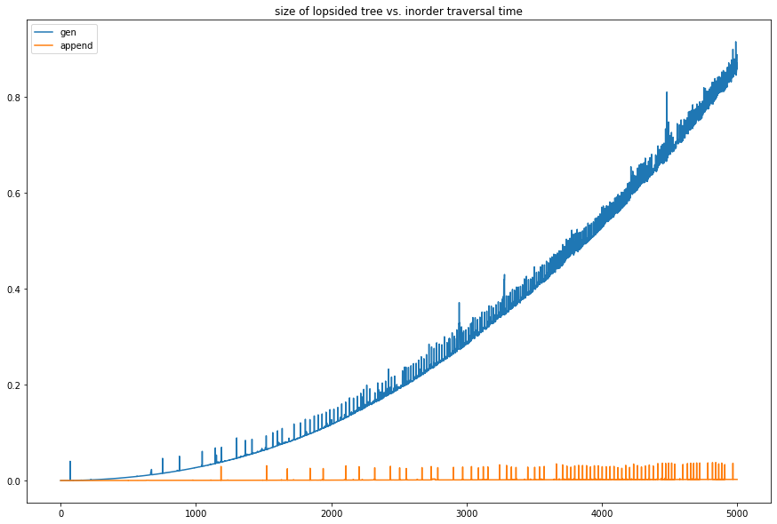
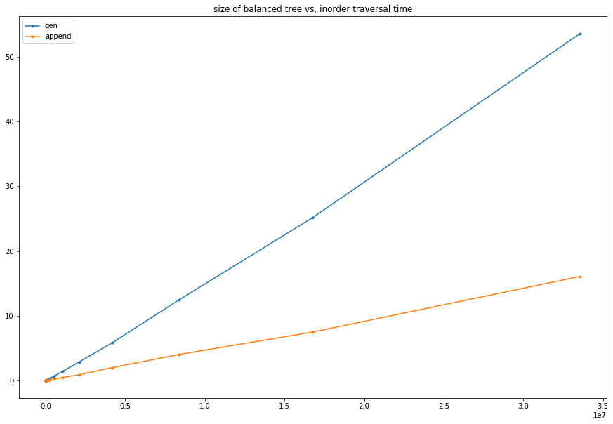

# Why is Python generator-based inorder traversal so slow?

**Author:** chuan-chih
**Votes:** 37
**Link:** [https://leetcode.com/problems/all-elements-in-two-binary-search-trees/solutions/464167/](https://leetcode.com/problems/all-elements-in-two-binary-search-trees/solutions/464167/)

---

The Python 3 solution below gets TLE for the last test case, both of whose trees are lopsided (each node has at most one child) and consist of 5000 nodes:
```
import heapq

class Solution:
    def getAllElements(self, root1: TreeNode, root2: TreeNode) -> List[int]:
        def gen(node):
            if node:
                yield from gen(node.left)
                yield node.val
                yield from gen(node.right)
        return list(heapq.merge(gen(root1), gen(root2)))
```
That last test case alone needs ~2.6s to finish and almost all of the time was consumed by the generators. The Python 2 equivalent is just as slow. In comparison, the following solution blazes through that last test case in ~80 ms:
```
import heapq

class Solution:
    def getAllElements(self, root1: TreeNode, root2: TreeNode) -> List[int]:
        def listify(node, l):
            if node:
                listify(node.left, l)
                l.append(node.val)
                listify(node.right, l)
        l1, l2 = [], []
        listify(root1, l1)
        listify(root2, l2)
        return list(heapq.merge(l1, l2))
```

I decided to get to the bottom of the issue experimentally. Here is the timing result of running inorder traversal for a lopsided tree to create a list of values, using generator vs. simple append with `listify()`:

x-axis is number of nodes, y-axis is traversal walltime in seconds. It seems that inorder traversal for a lopsided tree using generator is O(n^2)! Each level of nested generator results in constant overhead of yielding control from callee to caller, so for a nested generator the time complexity of yielding an item is O(d), d being the depth of nesting. O(n^2) time complexity for generator-based lopsided tree inorder traversal follows from that.

For completeness, here is the timing result of running inorder traversal for a balanced tree:


If all of the above is correct, the time complexity of generator-based inorder traversal for a balanced tree should be O(nlogn). It is hard to verify and distinguish from O(n) though, and the Jupyter Notebook kernal can't take it anymore \uD83E\uDD23

This exact problem was in fact mentioned in [PEP 380, Optimisations](https://www.python.org/dev/peps/pep-0380/#optimisations):
>Using a specialised syntax opens up possibilities for optimisation when there is a long chain of generators. Such chains can arise, for instance, when recursively traversing a tree structure. The overhead of passing \\_\\_next\\_\\_() calls and yielded values down and up the chain can cause what ought to be an O(n) operation to become, in the worst case, O(n\\*\\*2).

Evidently it hasn't been optimized away yet.