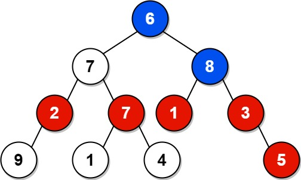

# [1315. Sum of Nodes with Even-Valued Grandparent](https://leetcode.com/problems/sum-of-nodes-with-even-valued-grandparent/)

| Category | Difficulty | Likes | Dislikes |
| :------: | :--------: | :---: | :------: |
| Algorithms | Medium | 2820 | 79 |

**Tags:** [`tree`](https://leetcode.com/tag/tree), [`depth-first-search`](https://leetcode.com/tag/depth-first-search), [`breadth-first-search`](https://leetcode.com/tag/breadth-first-search), [`binary-tree`](https://leetcode.com/tag/binary-tree)

**Companies:** `josh-technology`, `facebook`, `salesforce`, `microsoft`, `amazon`

## Description

Given the `root` of a binary tree, return *the sum of values of nodes with an **even-valued grandparent***. If there are no nodes with an **even-valued grandparent**, return `0`.

A **grandparent** of a node is the parent of its parent if it exists.

 

**Example 1:**


```

Input: root = [6,7,8,2,7,1,3,9,null,1,4,null,null,null,5]
Output: 18
Explanation: The red nodes are the nodes with even-value grandparent while the blue nodes are the even-value grandparents.

```

**Example 2:**


```

Input: root = [1]
Output: 0

```

 

**Constraints:**

	- The number of nodes in the tree is in the range `[1, 10^4]`.

	- `1 <= Node.val <= 100`

---

**Links:** [Submissions](https://leetcode.com/problems/sum-of-nodes-with-even-valued-grandparent/) | [Solutions](https://leetcode.com/problems/sum-of-nodes-with-even-valued-grandparent/)
