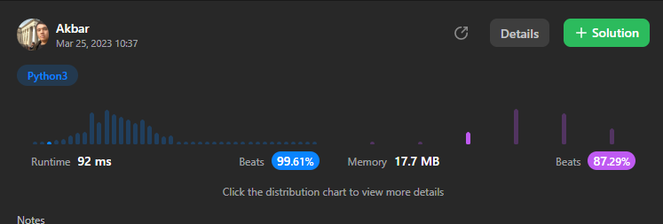

# Python3 || Beats 99.61% || DFS

**Author:** abdullayev_akbar
**Votes:** 24
**Link:** [https://leetcode.com/problems/sum-of-nodes-with-even-valued-grandparent/solutions/3338283/](https://leetcode.com/problems/sum-of-nodes-with-even-valued-grandparent/solutions/3338283/)

---


# Please UPVOTE\uD83D\uDE0A

# Python3
```
# Definition for a binary tree node.
# class TreeNode:
#     def __init__(self, val=0, left=None, right=None):
#         self.val = val
#         self.left = left
#         self.right = right
class Solution:
    def sumEvenGrandparent(self, root: TreeNode) -> int:
        def dfs(root,dad,gp):
            if not root:
                return 0
            x=0
            if(gp%2==0):
                x=root.val
            x+=dfs(root.left,root.val,dad)
            x+=dfs(root.right,root.val,dad)
            return x

        return dfs(root,1,1)
```