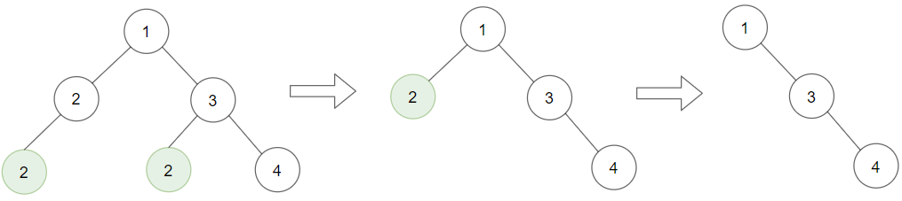
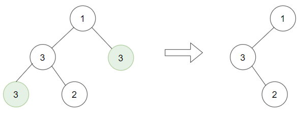
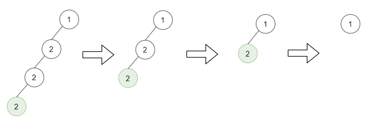

# [1325. Delete Leaves With a Given Value](https://leetcode.com/problems/delete-leaves-with-a-given-value/)

| Category | Difficulty | Likes | Dislikes |
| :------: | :--------: | :---: | :------: |
| Algorithms | Medium | 2868 | 58 |

**Tags:** [`tree`](https://leetcode.com/tag/tree), [`depth-first-search`](https://leetcode.com/tag/depth-first-search), [`binary-tree`](https://leetcode.com/tag/binary-tree)

**Companies:** `josh-technology`, `google`, `amazon`, `microsoft`

## Description

Given a binary tree `root` and an integer `target`, delete all the **leaf nodes** with value `target`.

Note that once you delete a leaf node with value `target`**, **if its parent node becomes a leaf node and has the value `target`, it should also be deleted (you need to continue doing that until you cannot).

 

**Example 1:**

****

```

Input: root = [1,2,3,2,null,2,4], target = 2
Output: [1,null,3,null,4]
Explanation: Leaf nodes in green with value (target = 2) are removed (Picture in left). 
After removing, new nodes become leaf nodes with value (target = 2) (Picture in center).

```

**Example 2:**

****

```

Input: root = [1,3,3,3,2], target = 3
Output: [1,3,null,null,2]

```

**Example 3:**

****

```

Input: root = [1,2,null,2,null,2], target = 2
Output: [1]
Explanation: Leaf nodes in green with value (target = 2) are removed at each step.

```

 

**Constraints:**

	- The number of nodes in the tree is in the range `[1, 3000]`.

	- `1 <= Node.val, target <= 1000`

---

**Links:** [Submissions](https://leetcode.com/problems/delete-leaves-with-a-given-value/) | [Solutions](https://leetcode.com/problems/delete-leaves-with-a-given-value/)
