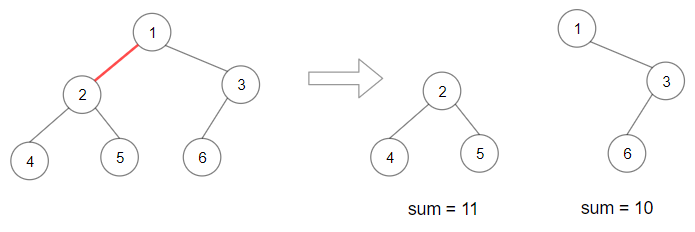
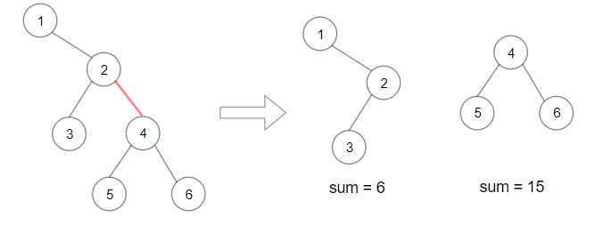

# [1339. Maximum Product of Splitted Binary Tree](https://leetcode.com/problems/maximum-product-of-splitted-binary-tree/)

| Category | Difficulty | Likes | Dislikes |
| :------: | :--------: | :---: | :------: |
| Algorithms | Medium | 3095 | 106 |

**Tags:** [`tree`](https://leetcode.com/tag/tree), [`depth-first-search`](https://leetcode.com/tag/depth-first-search), [`binary-tree`](https://leetcode.com/tag/binary-tree)

**Companies:** `amazon`, `microsoft`

## Description

Given the `root` of a binary tree, split the binary tree into two subtrees by removing one edge such that the product of the sums of the subtrees is maximized.

Return *the maximum product of the sums of the two subtrees*. Since the answer may be too large, return it **modulo** `10^9 + 7`.

**Note** that you need to maximize the answer before taking the mod and not after taking it.

 

**Example 1:**


```

Input: root = [1,2,3,4,5,6]
Output: 110
Explanation: Remove the red edge and get 2 binary trees with sum 11 and 10. Their product is 110 (11*10)

```

**Example 2:**


```

Input: root = [1,null,2,3,4,null,null,5,6]
Output: 90
Explanation: Remove the red edge and get 2 binary trees with sum 15 and 6.Their product is 90 (15*6)

```

 

**Constraints:**

	- The number of nodes in the tree is in the range `[2, 5 * 10^4]`.

	- `1 <= Node.val <= 10^4`

---

**Links:** [Submissions](https://leetcode.com/problems/maximum-product-of-splitted-binary-tree/) | [Solutions](https://leetcode.com/problems/maximum-product-of-splitted-binary-tree/)
