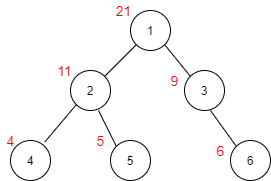
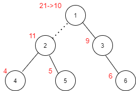

# [Python] Explained Solution with Diagrams || Beats 99%

**Author:** sevdariklejdi
**Votes:** 31
**Link:** [https://leetcode.com/problems/maximum-product-of-splitted-binary-tree/solutions/1413108/](https://leetcode.com/problems/maximum-product-of-splitted-binary-tree/solutions/1413108/)

---

I will use an example to explain the logic behind the solution of this exercise. Below you see a Binary Tree. In red, next to each node, you see the sum of all nodes' values rooted at the subtree. This information can be computed by running DFS on the tree (see the code in the end). For example, the sum of all nodes rooted at the node with value 2 is: 11= 2 + 5+ 4. We can note that the sum of all nodes rooted at the root of the tree is the total sum of all nodes. This information is important and we will use it later. 





Suppose we cut the edge connecting the node with value 1 and the node with value 2. 





What is the product of the sum of the subtrees? Well, we have already pre-calculated the sum of all nodes in the left subtree (rooted at 2) and we can note that the sum of all nodes in the right subtree is the total sum minus the sum of the left subtree. We have pre-calculated all the information we need! However, we do not know which edge deletion results in the maximum product, so we need to try all the edges. 

Further optimization arises from the fact that the exercise only requires the maximum product of the sums of any two subtrees, not the edge whose deletion resulted in the forming of these two subtrees. Hence, when we first run dfs on the tree to calculate the sums of the subtrees, we can keep all the sums in an array, removing the need to run dfs a second time. (However we will need to do a linear scan of the array and the time complexity remains the same). 

Here is the implementation: 

```
class Solution:
    def maxProduct(self, root: Optional[TreeNode]) -> int:
        
        sums = []
        def dfs(node):
            if node is None:
                return 0
            subtree_sum = dfs(node.left) + dfs(node.right) + node.val
            sums.append(subtree_sum)
            return subtree_sum
        
        
        m = -inf
        total = dfs(root)
        for i in sums:
            prod = i * (total-i)
            if prod > m: m = prod
        
        return m % (10**9 + 7)
```

If you found this helpful, please consider liking this post. 
