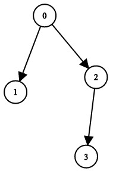
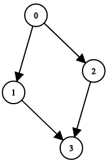
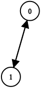

# [1361. Validate Binary Tree Nodes](https://leetcode.com/problems/validate-binary-tree-nodes/)

| Category | Difficulty | Likes | Dislikes |
| :------: | :--------: | :---: | :------: |
| Algorithms | Medium | 2237 | 522 |

**Tags:** [`tree`](https://leetcode.com/tag/tree), [`depth-first-search`](https://leetcode.com/tag/depth-first-search), [`breadth-first-search`](https://leetcode.com/tag/breadth-first-search), [`union-find`](https://leetcode.com/tag/union-find), [`graph`](https://leetcode.com/tag/graph), [`binary-tree`](https://leetcode.com/tag/binary-tree)

**Companies:** `facebook`, `microsoft`

## Description

You have `n` binary tree nodes numbered from `0` to `n - 1` where node `i` has two children `leftChild[i]` and `rightChild[i]`, return `true` if and only if **all** the given nodes form **exactly one** valid binary tree.

If node `i` has no left child then `leftChild[i]` will equal `-1`, similarly for the right child.

Note that the nodes have no values and that we only use the node numbers in this problem.

 

**Example 1:**


```

Input: n = 4, leftChild = [1,-1,3,-1], rightChild = [2,-1,-1,-1]
Output: true

```

**Example 2:**


```

Input: n = 4, leftChild = [1,-1,3,-1], rightChild = [2,3,-1,-1]
Output: false

```

**Example 3:**


```

Input: n = 2, leftChild = [1,0], rightChild = [-1,-1]
Output: false

```

 

**Constraints:**

	- `n == leftChild.length == rightChild.length`

	- `1 <= n <= 10^4`

	- `-1 <= leftChild[i], rightChild[i] <= n - 1`

---

**Links:** [Submissions](https://leetcode.com/problems/validate-binary-tree-nodes/) | [Solutions](https://leetcode.com/problems/validate-binary-tree-nodes/)
